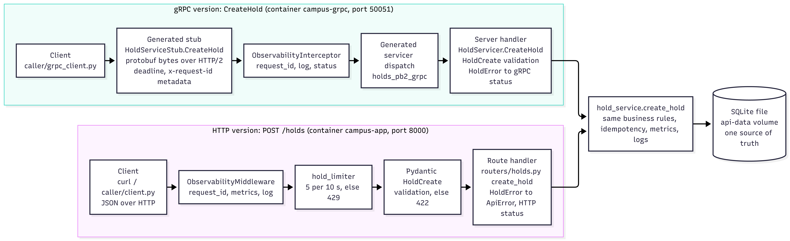

# Assignment 2: HTTP APIs, gRPC and Metrics

Enterprise Software Development, Fall 2026. The raw outputs for Part A (test runs, curl output,
caller output, screenshots) are in `evidence_part_02.md` at the repo root. This report gives the
explanations and tables and points to that evidence.

## Part A: Improve the HTTP API

### REST constraints

| Constraint | Plain meaning | In my API |
|---|---|---|
| Client-server | The client and the server are separate programs that only meet at the API, so each can change without the other. | Swagger UI, curl, `experiments/traffic.py` and `caller/client.py` all use the same FastAPI app, and none of them know that it stores data in SQLite. I could change the storage without touching a client. |
| Stateless | Every request carries everything the server needs. The server keeps no session between requests. | There is no login session. A staff call sends `X-Staff-Key` every time, and a hold request carries its own `Idempotency-Key`. The limiter keeps per-IP counters in memory, but that is bookkeeping and no request depends on an earlier one to be understood. It is also the reason the limit only works for a single instance. |
| Cacheable | Responses say whether they may be reused, so clients and proxies can avoid repeat calls. | Not demonstrated. The API sends no `Cache-Control` or `ETag`. I left it out on purpose because the menu changes with every hold, and a cached menu could show food that is already sold out. |
| Uniform interface | All resources are used in the same way: URLs name things, HTTP methods keep one meaning, standard status codes, one body format. | Mostly yes. Paths are nouns (`/holds/{id}`, `/items/{id}`), `GET` reads, `POST` creates, `PATCH` changes, errors use 404, 409, 422 and 429, and every error has the same JSON envelope. Two gaps: `pickup` and `cancel` are action paths (`POST /holds/{id}/pickup`), and responses carry no links to related resources (HATEOAS). |
| Layered system | The client cannot tell whether it talks to the server itself or to something in between. | Only weakly. Requests reach the app through Docker's port mapping, and Prometheus and Filebeat watch it from the side without the client noticing. I have no proxy or gateway in front of it. |
| Code on demand (optional) | The server can send code for the client to run. | Not used. The Swagger UI page at `/docs` is JavaScript, but it is documentation and not part of the API. |

### OpenAPI

The OpenAPI Specification is a standard file format (JSON or YAML) for describing an HTTP API:
its paths, methods, parameters, request bodies, status codes and response shapes. Because it is
machine-readable, tools can turn it into interactive docs such as Swagger UI, generate client
code, mock the server or check real responses against it, so the description can be tested
instead of only read. FastAPI builds it from the route definitions and the Pydantic models, which
keeps the spec and the code in step.

How I used it: `openapi.json` is exported from the running app and passes
`python -m openapi_spec_validator openapi.json`. It lists every application route (12 operations,
`/metrics` is hidden on purpose) with its inputs and its success and error responses, including
`429` and the `Idempotency-Key` header on `POST /holds`. I used it through Swagger UI ("Try it
out" on `POST /holds` with `{"item_id": 0}`): the `422` that came back has the shape the spec
documents for that response. Evidence: `evidence_part_02.md`, section A6.

### User task: place a hold (`POST /holds`)

The path and method stay the same, since `POST /holds` is already a noun path with the right
verb. What changed is how it behaves.

| Before | Problem | Change | Reason |
|---|---|---|---|
| `POST /holds` accepted `item_id` of 0 or less and ignored unknown fields | `item_id: 0` came back as "404 item not found", and a typo such as `pickup_in_minute` was silently ignored, so the hold got the default 180 minutes | `item_id` must be greater than 0, unknown fields are rejected with 422 that names the field | The client sees its own mistake at once instead of a wrong hold or a misleading 404 |
| Errors were FastAPI's default `{"detail": ...}`, a string for 404 and 409 and a list for 422 | No stable error code and no request ID in the body, so a client could only parse text and an error report could not be tied to a log line | One envelope for every error: `{"error": {"code", "message", "request_id", "details"?}}`, also for unknown routes | Clients can switch on `code`, and `request_id` finds the log line |
| A retry after a timeout created a second hold | The client cannot tell whether the first request worked, so retrying took a second portion of food | Optional `Idempotency-Key` header. Same key and body returns the first hold with `Idempotent-Replayed: true`, same key with a different body returns 422 `IDEMPOTENCY_KEY_REUSED` | Makes retries safe, which the Python caller depends on |
| No limit on hold requests | A loop could take every portion of an item in a few seconds | 5 requests per 10 s per client IP, then `429` with `Retry-After` | Protects the shared stock and the server |
| Response had no schema and no error responses in the spec | The spec said `{}` for the response, so it could not be used to test the endpoint | `response_model=HoldOut` and documented 404, 409, 422 and 429 | The spec now describes what the endpoint really returns |

Rate limit details: 5 requests per 10 seconds, shared by all callers with the same client IP
(inside Docker, requests from the host often share the gateway IP), allowed again when the oldest
counted request leaves the window, which is the number of seconds in `Retry-After`. Rejected
requests are not counted. Evidence: `evidence_part_02.md`, section A4.

### Other endpoints

| Endpoint | Changed? | What |
|---|---|---|
| `GET /eateries` | Left alone | No input and no expected failure |
| `GET /eateries/{eatery_id}/menu` | Changed | 404 uses the envelope (`EATERY_NOT_FOUND`), 404 and 422 documented |
| `GET /items/{item_id}` | Changed | Envelope (`ITEM_NOT_FOUND`), typed response |
| `PATCH /items/{item_id}/availability` | Changed | Envelope for 401 (`STAFF_KEY_REQUIRED`) and 404, unknown fields rejected, typed response. Repeating it is already safe because it sets an absolute value |
| `GET /holds/{hold_id}` | Changed | Envelope (`HOLD_NOT_FOUND`), typed response |
| `POST /holds/{hold_id}/pickup`, `POST /holds/{hold_id}/cancel` | Changed | Envelope, 404 `HOLD_NOT_FOUND`, repeat returns 409 `HOLD_NOT_ACTIVE` and changes nothing. Action paths left as they are |
| `GET`, `POST`, `DELETE /admin/faults` | Changed | Envelope for 401, unknown fields rejected. Staff-only tool for Experiment E1 |
| `/health`, `/metrics` | Excluded | As the assignment says |

### Callers

The only callers of the old error format were my own scripts. `experiments/traffic.py` checks
status codes and never reads `detail`, and the Assignment 1 run after the change still worked
(`evidence_part_02.md`, section A7). The README curl examples are unchanged. `caller/client.py` is
new.

### Tests and reliability results

Valid request, invalid input and repeated request are covered by the automated tests
(`test_create_hold_valid`, `test_create_hold_invalid_input`,
`test_repeated_request_same_key_creates_one_hold`). The caller's timeout, retry, breaker and
recovery output is in `evidence_part_02.md`, section A5, with these settings: connect timeout 1 s,
read timeout 2 s, 3 attempts per call with 0.5 s then 1 s backoff, breaker opens after 3
consecutive failed attempts, recovery period 10 s. The failure used was a 3000 ms menu delay from
the Assignment 1 fault switch, and rate limiting is shown separately.

**Rate-limit result** (`POST /holds`, limit 5 per 10 s per client IP; evidence section A4):

| Request | Result |
|---|---|
| 1 to 5 | `201 Created` |
| 6 and 7 | `429 Too Many Requests`, `Retry-After: 10`, error code `RATE_LIMITED` |
| After waiting 10 s | `201 Created` again |

**Python caller result** (`caller/client.py`; evidence section A5). The failure was the Assignment 1
menu delay of 3000 ms, which is longer than the 2 s read timeout:

| Phase | What the output shows |
|---|---|
| 1. Healthy server | Three menu reads return `200`, and a hold is created with an `Idempotency-Key` (`201`) |
| 2. Delay injected | Attempt 1 fails with `ReadTimeout`, retry after 0.52 s. Attempt 2 fails, retry after 1.08 s. Attempt 3 fails and the breaker goes `closed -> open`. The next two calls are `BLOCKED`: no request is sent |
| 3. Fault removed | After the 10 s recovery period the breaker goes `open -> half_open`, the trial call returns `200`, the breaker goes `half_open -> closed`, and the next call returns `200` |

## Part B: gRPC service

The operation is `POST /holds` (create a hold), as `CreateHold` in
`api/campus_api/rpc/holds.proto`. Both versions call `hold_service.create_hold`, so the rules
(stock check, idempotency, metrics, logs) exist once and use the same SQLite file, shared through
the `api-data` volume. The gRPC handler does not call the HTTP API.

### Proto, generated code and client

The RPC and messages are defined in `api/campus_api/rpc/holds.proto` (service `HoldService` with
one unary RPC, `CreateHold`). The Python code is generated from the `api/` folder with:

```
pip install grpcio-tools
python -m grpc_tools.protoc -I. --python_out=. --grpc_python_out=. campus_api/rpc/holds.proto
```

This writes `holds_pb2.py` (the messages) and `holds_pb2_grpc.py` (the client stub and the server
dispatch). The handler `HoldServicer.CreateHold` is in `api/campus_api/grpc_server.py`, and the
service runs in its own container, `campus-grpc`, on port 50051.

The client is `caller/grpc_client.py`. It takes the item ID as input (`--item-id`), sets a deadline
on every call (2 s by default, changed with `--deadline`), sends an `x-request-id`, and prints the
transport, request ID, status, application error code, message and duration. `--via http` sends
the same operation to the HTTP version.

### Call paths



*Figure B-1: both versions of the operation. The generated stub (`HoldServiceStub`) and the
generated servicer dispatch (`holds_pb2_grpc`) come from `holds.proto`. The handler is
`HoldServicer.CreateHold` in `grpc_server.py`.*

### Status mapping

The business rule fails with one stable code. Each version turns it into its own status.

| Situation | Code | HTTP | gRPC | Why this gRPC status |
|---|---|---|---|---|
| Hold created | none | 201 Created | OK | |
| Same key and body repeated | none | 201 plus `Idempotent-Replayed: true` | OK with `replayed = true` | The repeat is a success in both |
| Item does not exist | `ITEM_NOT_FOUND` | 404 Not Found | NOT_FOUND | Same meaning |
| Item sold out | `ITEM_SOLD_OUT` | 409 Conflict | FAILED_PRECONDITION | The item is not in the state the call needs |
| Bad input (`item_id` 0, `pickup_in_minutes` out of range) | `VALIDATION_ERROR` | 422 Unprocessable Entity | INVALID_ARGUMENT | The request itself is wrong |
| Key reused with a different body | `IDEMPOTENCY_KEY_REUSED` | 422 | INVALID_ARGUMENT | Same as bad input |
| Too many calls | `RATE_LIMITED` | 429 plus `Retry-After` | not applied | The limiter is HTTP only, see below |
| Unexpected failure | `INTERNAL_ERROR` | 500 | INTERNAL | |
| Deadline passed or server unreachable | none | client timeout | DEADLINE_EXCEEDED or UNAVAILABLE | Set by the client's deadline |

The gRPC error code is also sent in the `x-error-code` trailing metadata, so a client does not
have to parse the message.

The rate limiter is applied to the HTTP route only. It is an in-memory, per-process limiter for
the HTTP edge, so a second process would have its own separate counters. The gRPC version is not
limited. I state this as a limitation instead of hiding it.

### HTTP and gRPC examples

Both versions were called with the same inputs through `caller/grpc_client.py` (evidence sections
B2 to B6):

| Case | HTTP | gRPC | Meaning |
|---|---|---|---|
| New hold (`item_id` 1) | `201 Created` | `OK` | The request worked and a hold exists |
| Unknown item (`item_id` 9999) | `404 Not Found`, `ITEM_NOT_FOUND` | `NOT_FOUND`, `ITEM_NOT_FOUND` | The thing asked for is not there |
| Sold-out item (item 2 switched off) | `409 Conflict`, `ITEM_SOLD_OUT` | `FAILED_PRECONDITION`, `ITEM_SOLD_OUT` | The request is fine, but the item is not in the state the call needs |
| Invalid input (`item_id` 0) | `422`, `VALIDATION_ERROR` | `INVALID_ARGUMENT`, `VALIDATION_ERROR` | The request itself is wrong |

The two successful holds have consecutive IDs (457 over gRPC, 458 over HTTP) because both services
write to the same database. The command-line client starts a new process and a new channel for
every call, so its durations (about 20 to 70 ms) include connection setup and are not a fair
HTTP-against-gRPC comparison. The server-side durations in Part C are.

### Logs across the boundary

The client sends its request ID as `x-request-id` metadata. The interceptor in `grpc_server.py`
sets it for the call, so every log line of the call (`hold_created`, `hold_rejected`,
`grpc_call_completed`) carries it, and it is returned in the initial metadata. The log line for
the call is `grpc_call_completed` with the fields `method` and `grpc_status` (not `status`,
because Elasticsearch maps `app.status` as a number). Filebeat now keeps logs from the
`campus-grpc` container as well as `campus-app`.

Evidence for this part is in `evidence_part_02.md`, section B: one success and two failures (item not
found, item sold out) through both versions with their statuses, the five gRPC log documents that
three calls produced, and Kibana searches by request ID (`a2-grpc-ok`, `a2-grpc-notfound`). The tests in `api/campus_api/tests/test_grpc.py` (the whole suite has 33 tests, all passing) cover the same cases plus idempotent repeats, the shared database and the request ID in metadata.

## Part C: Extend the metrics

### Audit of the Assignment 1 metrics

| Area | Verdict | What I found | What I did |
|---|---|---|---|
| `campus_http_requests_total`, `campus_http_request_duration_seconds`, `campus_http_requests_in_progress` | Useful, one weakness | They show traffic, errors and latency per route. The lowest histogram bucket was 5 ms, but almost every request is faster, so p50 and p95 were bucket artifacts (the Assignment 1 report shows a 4.8 ms baseline p95 for requests that take about 1.4 ms) | Added buckets at 1 ms and 2.5 ms. The Assignment 1 numbers were measured with the old buckets |
| `campus_holds_placed_total`, `campus_holds_rejected_total` | Useful | Two processes now record them (HTTP and gRPC), and the panel already uses `sum()`, so it stays correct | Nothing |
| `campus_hold_creation_seconds` (Summary) | Useful, average only | Both processes record it, so the average panel showed two series with the same legend | Panel 9 is now `sum(rate(..._sum)) / sum(rate(..._count))` |
| `campus_items_available`, `campus_active_holds` (gauges) | Useful, but went stale | They were refreshed only by the HTTP process, so a hold created over gRPC showed up only at the next background job run, up to 30 s later | `/metrics` recomputes them from the database on every scrape (every 5 s) |
| gRPC service | Missing | The new service had no metrics and was not scraped | Added three metrics, a metrics port (9102) and the Prometheus job `campus-food-grpc` |
| Idempotent replays | Missing | A repeated `Idempotency-Key` only wrote a log line, so its rate could not be charted | Added `campus_hold_replays_total` |
| Rate-limit rejections | Not needed | The limiter is the only source of `429`, which `campus_http_requests_total{status="429"}` already counts | Nothing |
| HTTP-only metrics inside the gRPC process | Noise | The gRPC process imports the same metrics module, so it exposed empty or zero HTTP series that duplicate the HTTP process's series in Grafana | The gRPC process unregisters them at start-up and exposes only what it records |
| Not added | | Time spent waiting for the SQLite write lock, and client-side duration. The lock wait would matter under heavy load, but at this scale a call takes a few milliseconds. The Python caller does not need a metrics endpoint | |

### New and changed metrics

| Metric | Purpose | Type | Unit | Labels | Code location | Query |
|---|---|---|---|---|---|---|
| `campus_grpc_requests_total` | Calls and errors per RPC method and status | Counter | calls | `method` (`CreateHold`), `status` (gRPC status name, at most 17 values) | `grpc_server.py`, `ObservabilityInterceptor.wrapped` | `sum by (method, status) (rate(campus_grpc_requests_total[1m]))` and error rate `100 * sum(rate(campus_grpc_requests_total{status!="OK"}[1m])) / sum(rate(campus_grpc_requests_total[1m]))` |
| `campus_grpc_request_duration_seconds` | How long the server takes, for p50 and p95 | Histogram | seconds | `method` | same place | `histogram_quantile(0.95, sum by (le) (rate(campus_grpc_request_duration_seconds_bucket{method="CreateHold"}[5m])))`, and `0.5` for p50 |
| `campus_grpc_requests_in_progress` | Calls being handled right now | Gauge | calls | `method` | same place | `sum by (method) (campus_grpc_requests_in_progress)` |
| `campus_hold_replays_total` | How often clients retry a hold with the same key | Counter | replays | none | `hold_service.py`, `create_hold` (both services) | `sum by (job) (rate(campus_hold_replays_total[1m]))` |

The duration histogram uses buckets of 1, 2.5, 5, 10, 25, 50, 100, 250, 500 ms and 1, 2.5, 5 s. A call
takes a few milliseconds, so the low buckets matter, and the upper ones are there for slow calls and
for the delay used in the burst test.

Duration is measured at the server. The interceptor starts a timer when the handler is entered and
stops it when it returns or aborts, so the value leaves out network time and the protobuf encoding
and decoding that the generated code does outside the interceptor. It is not a client-side number.
The HTTP histogram is measured in the same way, around the route, so the two are comparable.

Labels are bounded. `method` is the RPC name, so it has one value for the one RPC in the `.proto`.
`status` is one of the gRPC status names. Request IDs, hold IDs, item IDs and idempotency keys are
never labels (they are in the logs, where Elasticsearch is built for them). A test checks this
(`test_grpc_metric_labels_stay_bounded`).

Why in-flight calls and not message size: the request and response messages are a few dozen bytes
each and almost constant, so a size metric would be a flat line. In-flight calls shows saturation,
which is the thing to watch if many clients call at once. It is also not interesting at normal load,
because a call takes a few milliseconds and a 5 s scrape almost always sees 0. For that reason the
load script has a burst phase that holds each call for 300 ms using a staff-key-protected delay
switch (`x-fault-delay-ms` metadata, like Assignment 1's fault switch), so 8 concurrent workers keep
about 8 calls in flight.

### Grafana

The dashboard "Create hold: HTTP vs gRPC" (`monitoring/grafana/dashboards/create-hold-http-vs-grpc.json`,
loaded automatically) puts the HTTP panels on the left and the gRPC panels on the right:

| Row | HTTP `POST /holds` (left) | gRPC `CreateHold` (right) | Window |
|---|---|---|---|
| Calls and errors | calls per second by status, error % | calls per second by method and status, error % | 1 minute |
| Duration | p50 and p95 | p50 and p95 | 5 minutes |
| Load | `campus_http_requests_in_progress` (all routes, it has no route label) | `campus_grpc_requests_in_progress` | none (gauge) |
| Extra metric | replays per second, job `campus-food-api` | replays per second, job `campus-food-grpc` | 1 minute |

Percentiles come from histogram buckets, so they are estimates (see the note on bucket
interpolation in the Assignment 1 report). The HTTP error percentage includes `429`, `404`, `409`
and `422`, and the gRPC one includes every status other than `OK`.

### Repeatable calls

`experiments/hold_load.py` sends the same fixed sequence every run. Phase 1 sends 10 rounds of 8
calls to each of HTTP and gRPC (4 new holds, 1 repeat of a key, 1 unknown item, 1 invalid `item_id`,
1 sold-out item), so each transport gets: 50 successes (40 new holds and 10 replays), 10 not found,
10 invalid and 10 sold out. Phase 2 is a 20 s burst against gRPC only (8 workers, 300 ms held per
call), where the numbers depend on timing. The holds the script creates are cancelled at once, and
item 2 is switched off for the sold-out calls and switched back on at the end. The HTTP rate limit
is raised for the run (`HOLD_RATE_LIMIT=1000`), because 80 calls would otherwise hit the 5 per 10 s limit.

The Part C evidence (target UP, run output, raw `/metrics`, dashboard screenshots) is in
`evidence_part_02.md`, section C.

### Dashboard results

The load run of `experiments/hold_load.py` (run id `04e411`, 2026-10-25, 23:25:23 to 23:26:13 local
time) and the dashboard screenshots are in `evidence_part_02.md`, section C. In short:

| Check | Result |
|---|---|
| Prometheus target `campus-food-grpc` (`campus-grpc:9102`) | UP |
| Counters against the script | `OK` 227 = 50 (phase 1) + 176 (burst) + 1 (burst setup call); `NOT_FOUND` 186 and `INVALID_ARGUMENT` 186 = 10 + 176; `FAILED_PRECONDITION` 10 |
| Error rate | gRPC about 38 % in phase 1 (30 failures in 80 calls), about 67 % in the burst (352 in 528). HTTP about 37 to 46 % |
| Calls in flight | gRPC peaks at 8 during the burst (8 workers) and is 0 otherwise. HTTP stays at 0 |
| Duration, server side, 5 minute window | HTTP p50 about 40 ms, p95 about 87 ms. gRPC p50 about 360 ms, p95 about 480 ms: every burst call is held for 300 ms, and the estimate is interpolated inside the 0.25 to 0.5 s bucket, so it overstates the real time |
| Replays | gRPC 186 (10 in phase 1 + 176 in the burst). HTTP 2, from two manual checks (the HTTP counter restarted when the API container was recreated after the run) |

## Limitations

- The rate limiter is in memory and per process, and it is applied to the HTTP route only, so the gRPC
  version is not limited.
- The limiter groups callers by client IP. Inside Docker, requests from the host often share one IP.
- Percentiles are estimates from histogram buckets and can overstate the real value by up to the
  width of a bucket.
- Duration is measured at the server, so it leaves out network time and protobuf encoding.
- Item 2 is switched off during the load run to produce sold-out calls and switched back on at the end.

## Credits and assistance

I credit the following sources. The libraries and tools I used are FastAPI, Prometheus, Grafana,
Node Exporter, Filebeat, Elasticsearch and Kibana; the exact version of each is pinned in
`docker-compose.yml`. As for AI assistance, I used Claude (web) for code assistance and for reviewing this report.
