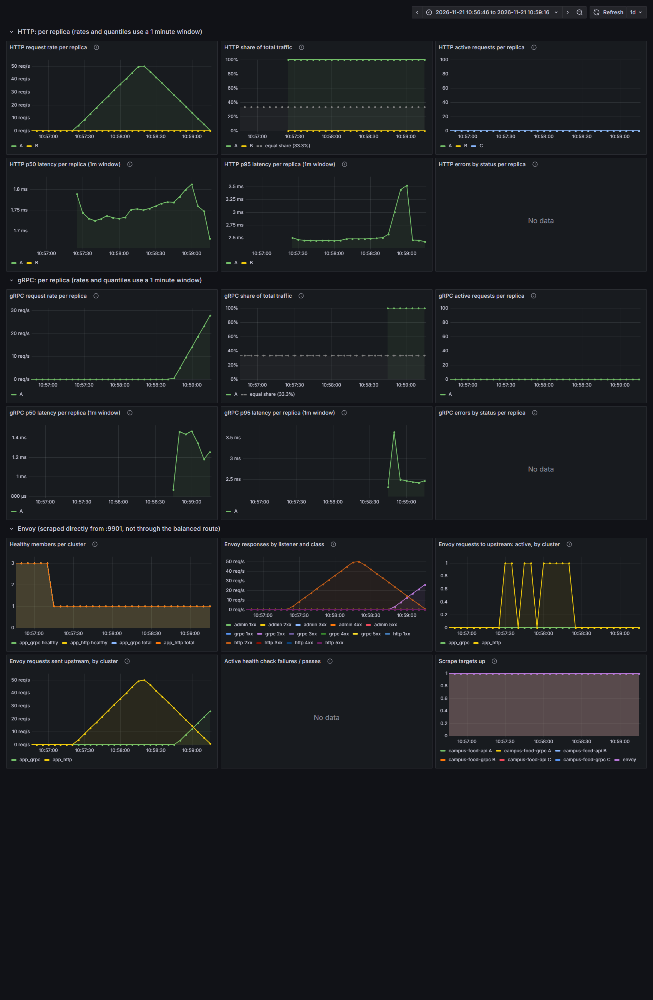
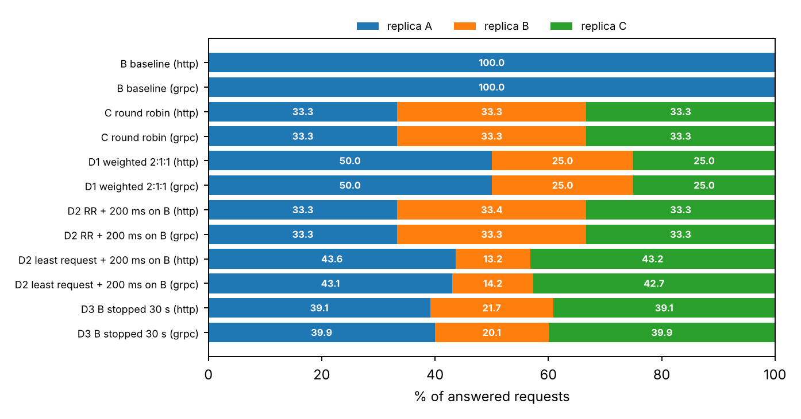
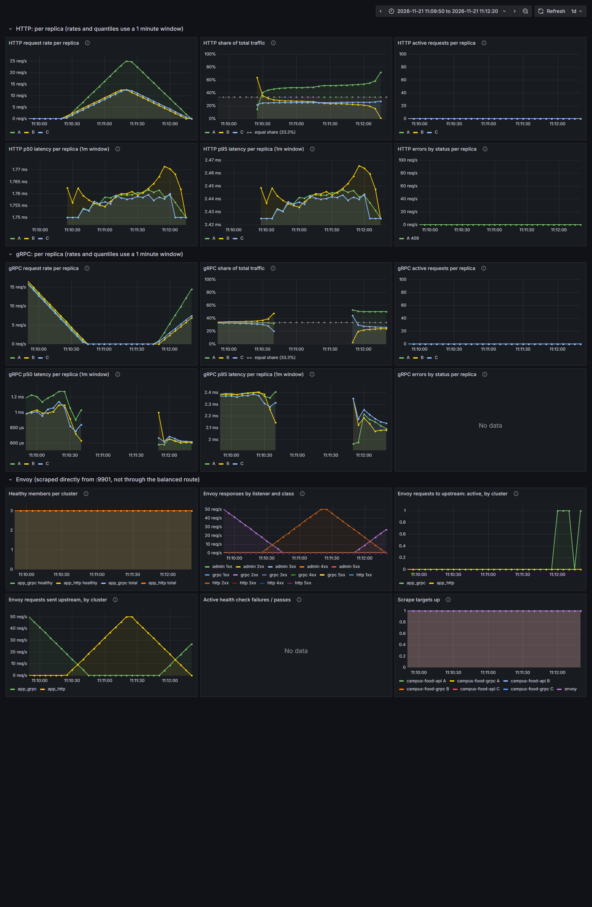
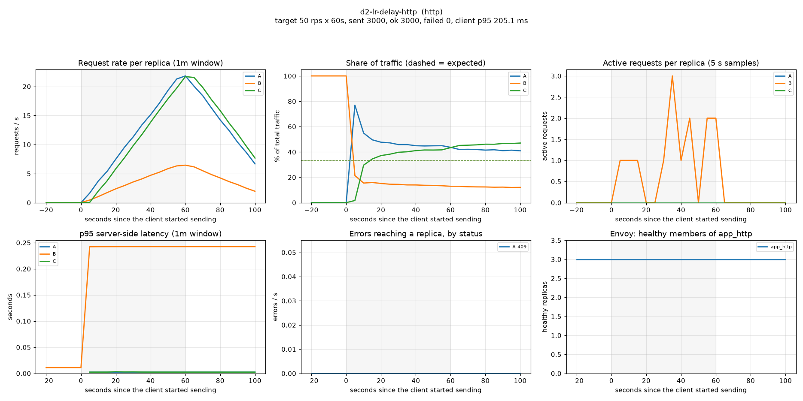
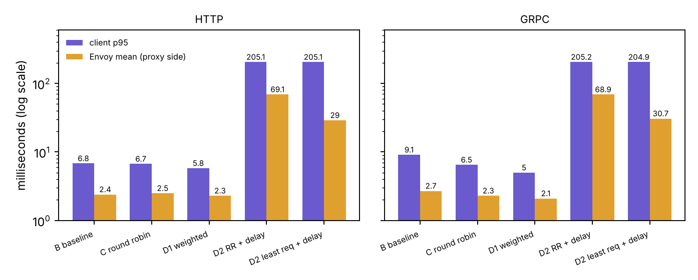
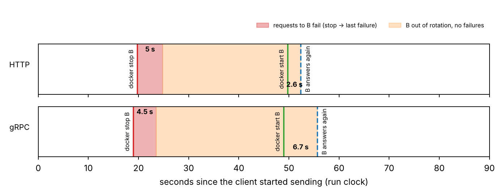

# Assignment 3: Load Balancing and Observability

Enterprise Software Development, Fall 2026. Individual assignment, extends A2 (HTTP API and gRPC *CreateHold*, metrics, logs). Reused work: the A1/A2 metrics, JSON logging, Filebeat/Elasticsearch/Kibana pipeline and the hold-service rules (A2 report). All numbers come from my own runs (50 requests per second; 60 s per run, 90 s for the failure run) and from the collected evidence (client results, Prometheus, Envoy access logs).

## 1. Architecture and shared state

One container is one replica and runs both the HTTP server and the gRPC server. *docker compose up -d --scale app=3* creates *campus-food-app-1..3*, called A, B and C. Envoy is the only entry point (HTTP :8000, gRPC :50051, the addresses clients already used); replicas publish no host ports. In Parts A and B both Envoy clusters list only A, while B and C run and receive nothing. From Part C all three are listed. Prometheus scrapes A, B, C (HTTP metrics on :8000, gRPC metrics on :9102) and Envoy (:9901) directly by container name, never through the balanced route.


*Figure 1. Architecture. Solid lines: traffic in Part C. Dashed: destinations added in Part C.*

**Replica identity and correlation.** The replica letter appears in every application log line, in the *X-Replica* response header and gRPC *x-replica* metadata, and as the Prometheus label *replica* (set in the scrape configuration). Envoy keeps the client's *X-Request-ID* (or creates one) and forwards it; the application already uses it as its request id. Filebeat copies Envoy's and the application's id into one *trace_id* field, so one search on *trace_id* returns both events. Envoy records the answering replica from the *x-replica* header.

| State | Where it lives | Shared by all replicas? | What goes wrong when requests are spread across replicas |
|---|---|---|---|
| Data (eateries, items, stock, holds) | One SQLite file on volume api-data | **Yes**. The file lock serialises writers; the stock decrement is one atomic UPDATE. | Consistent. Limits: one host and writers queue on the file lock; a real deployment needs a networked database. |
| Idempotency records | Table idempotency_keys, written in the same transaction as the hold | **Yes** | Nothing: a retry that lands on another replica replays the original hold (shown below). |
| Rate-limit counters (POST /holds) | Python dict in each replica's memory | **No** | Each replica counts only its own share, so the effective limit is about N times the configured one, and a restart resets that replica's counters (shown below). |
| Background job (hold expiry, daily menu reset) | Runs in every replica | n/a | Could double-count expiries or reset the menu twice. Each step now takes the write lock first (BEGIN IMMEDIATE), so one replica acts. |
| Startup seeding | Every replica calls seed_if_empty | n/a | Three replicas starting together would insert the same primary keys and crash. Fixed the same way. |

Two further changes were needed because of the proxy: the rate limiter now keys on the last *X-Forwarded-For* entry (the address Envoy saw; otherwise every client looks like Envoy's own address and all share one bucket), and */health* is no longer logged or counted so health checks do not pollute rates, shares or logs.

**Evidence for shared and separate state** (round-robin stage). *Idempotency:* nine POST /holds requests with one Idempotency-Key were sent through Envoy. In the evidence run replicas A, B and C answered 4, 3 and 2 of them, and in a repeat run 3, 2 and 4 (never exactly 3/3/3, probably because every request opened a new connection and Envoy keeps its round-robin position per worker thread). In both runs all nine answers carried the same hold id (553) and all nine were replays of it: the hold had been created by the same key in an earlier run, so every request, including those answered by replicas that never saw the original, returned the stored hold from the shared database and no duplicate was created. (The script's first version printed FAIL because it assumed a fresh key, which gives one creation plus eight replays; after accepting both cases it prints PASS for the same outcome.) *Rate limit:* 30 quick POST /holds requests with different keys gave 15 accepted (201) and 15 rejected (429) in both runs. A single replica would accept 5 per window; 15 is exactly 3 replicas x 5, which shows that the counters are per replica.

**Test traffic.** HTTP: *GET /eateries/1/menu* (read-only). gRPC: *CreateHold* with one fixed idempotency key, so every timed call is a replay (no new rows; A2 has no read-only RPC); one gRPC channel, i.e. one TCP connection, for the whole run. The client is open loop: request i is sent at t0 + i/rate whether or not earlier responses have returned, and latency is measured from the scheduled send time; it never retries.

## 2. Envoy configuration and health checks

Envoy's configuration is generated by a script with one stage flag per run, so every run is reproducible. Both listeners use the HTTP connection manager, so each gRPC call is routed on its own although the client keeps one connection; the gRPC cluster speaks HTTP/2 to the replicas. A plain TCP proxy would pin the whole connection to one replica. Retries are off (no retry policy), circuit-breaker limits are raised to 100000 so Envoy's defaults never act (confirmed with the admin /clusters output: max_requests 100000, max_retries 0), and outlier detection is not configured. Policies: ROUND_ROBIN, weights through load_balancing_weight, and LEAST_REQUEST with Envoy's default of two random choices (compare two random replicas, pick the one with fewer active requests).

| Health-check setting (D3 only) | Value |
|---|---|
| Check | HTTP GET /health on each replica's port 8000 (also used for the gRPC cluster; same container) |
| interval / no_traffic_interval / unhealthy_interval | 2 s / 2 s / 2 s |
| timeout | 1 s |
| unhealthy_threshold / healthy_threshold | 2 consecutive failures / 2 consecutive successes (a brand-new host needs 1) |
| DNS refresh | 5 s (replicas are reached by container name) |
| Expected removal after the stop | about 2 to 5 s: next check in 0 to 2 s, one more interval (2 s), up to 1 s of timeout |
| Expected recovery after the restart | application start-up, then up to 5 s until Envoy sees the restarted replica again (DNS refresh), then 1 to 2 successful checks |

## 3. Metrics and queries (dashboard "A3: Load balancing")

| Panel | Query (HTTP shown; gRPC uses campus_grpc_\* and status != "OK") |
|---|---|
| Request rate per replica | sum by (replica) (rate(campus_http_requests_total[1m])) |
| Share of total traffic | 100 \* sum by (replica)(rate(...[1m])) / scalar(sum(rate(...[1m]))), with a dashed reference at 100/3 |
| Active requests | sum by (replica) (campus_http_requests_in_progress) |
| p50 / p95 (1 minute window) | histogram_quantile(q, sum by (le, replica) (rate(campus_http_request_duration_seconds_bucket[1m]))) |
| Errors by status | sum by (replica, status) (rate(campus_http_requests_total{status!~"2.."}[1m])) |
| Envoy row | envoy_cluster_membership_healthy, envoy_http_downstream_rq_xx, envoy_cluster_upstream_rq_active, envoy_cluster_health_check_\* |

Labels are bounded (replica, method, route template, status); no request, trace or item ids. Rates and quantiles use a 1 minute window; the scrape interval is 5 s. How to read the curves: a 1 minute rate window needs 60 s of data and my runs last 60 s, so the rate ramps up and peaks at the end of the run; exact shares therefore come from counter differences over the whole run, and the rate curves show the dynamics. A counter that appears on the first request has no rate until it has two samples, and replicas are scraped at slightly different moments, so shares wobble at the start and end of a run (for example 53/22/25 instead of 50/25/25 at the end of D1 while the counts are exactly 1500/750/750). Server-side durations leave out network and Envoy time, and histogram quantiles snap to bucket edges (a 200 ms delay appears as 0.24 s). Active requests is a gauge sampled every 5 s; at 50 rps and about 4.5 ms per request Little's law gives about 0.2 requests in flight in the whole system, so it is almost always 0 in healthy runs. Requests that Envoy cannot deliver never reach a replica, so they appear only in the Envoy row and in the client results.

## 4. Baselines

**Part B: A only.** Fixed 50 rps for 60 s. A handles all traffic; B and C are running and idle, as expected.

| Interface | Sent / OK / failed | Client p50 / p95 / p99 | Envoy (proxy side) mean / p95 | A / B / C requests |
|---|---|---|---|---|
| HTTP | 3000 / 3000 / 0 | 4.2 / 6.8 / 10.2 ms | 2.4 / 4.0 ms | 3000 / 0 / 0 |
| gRPC | 3000 / 3000 / 0 | 4.7 / 9.1 / 14.8 ms | 2.7 / 5.1 ms | 3000 / 0 / 0 |

The Envoy access log, Prometheus and the client agree on every count (the gRPC runs show 3001 in Prometheus and in Envoy's log because the single untimed set-up call that creates the hold is counted too). In the dashboard the "healthy members" panel falls from 3 to 1 about 10 s before the run: that is the stage switch (Envoy was recreated from the three-replica to the A-only configuration), not a failure.



*Figure 2. Grafana, Part B baseline (HTTP row above, gRPC row below). A carries all traffic; the share panel sits at 100% for A and 0% for B; no errors.*

**Part C: equal-weight round robin.** Same workload.

| Interface | Client p50 / p95 / p99 | Envoy mean / p95 | A / B / C requests (client) | Prometheus / Envoy log |
|---|---|---|---|---|
| HTTP | 4.5 / 6.7 / 10.5 ms | 2.5 / 4.0 ms | 1000 / 1000 / 1000 (33.3 / 33.3 / 33.3 %) | 1000 / 1000 / 1000, identical |
| gRPC | 4.3 / 6.5 / 8.9 ms | 2.3 / 3.2 ms | 1000 / 1000 / 1000 (33.3 / 33.3 / 33.3 %) | 1000 / 1001 / 1000 (+1 = set-up call on B) |

Each replica gets exactly one third, for both interfaces. gRPC is spread evenly because the HTTP/2 listener routes every call separately: all 3000 calls travelled over one client connection and still reached all three replicas. Compared with the A-only baseline, client latency is the same within run-to-run noise (p95 6.8 to 6.7 ms for HTTP; 9.1 to 6.5 ms for gRPC, the baseline being a little higher in a single run): at 50 rps one replica is nowhere near saturation, so spreading the load removes no queueing. What changed is the load on each replica, from 50 requests per second on A to about 16.7 on each. In the dashboard the curve starts at 100% for A and converges to 33% within about 30 s; that is the series-start and scrape-timing effect from section 3, not uneven balancing. These runs are the round-robin baseline for Part D.



*Figure 3. Share of answered requests per replica for every run (client counts, equal to the Envoy access-log counts).*

## 5. Experiments

Each experiment starts from the healthy round-robin setup with the same workload and is restored afterwards. HTTP and gRPC are reported separately. Predictions were written before the runs.

### D1: weighted round robin, A:B:C = 2:1:1

**Prediction.** Shares 50/25/25 for both interfaces. Nothing is saturated at 50 rps, so latency barely changes; A's active requests are about double B's and C's. A higher weight sends more traffic; it adds no capacity.

**Observation.** HTTP and gRPC both gave 1500 / 750 / 750 requests, exactly 50 / 25 / 25 % (Prometheus and Envoy's log agree; gRPC shows one extra call on C from the set-up call). Client p95 was 5.8 ms (HTTP) and 5.0 ms (gRPC) against 6.7 and 6.5 ms in plain round robin; Envoy-side mean 2.3 and 2.1 ms. Active requests stayed at 0 in every sample.

**Explanation.** Weighted round robin hit its targets exactly. Latency did not rise because A's rate (25 rps) times its service time of a few milliseconds is far below one request in flight; the slightly lower p95 is single-run noise, not a gain from the weights. Active requests could not differ for the same reason. This is the warning in the assignment: a weight changes who receives the traffic, not how much a replica can handle. Had A been near its limit, giving it twice the requests would have raised its latency; this workload is too light to show that.



*Figure 4. Grafana, D1 weighted 2:1:1: A near 50%, B and C near 25% in the share panels, flat latency, no errors (the first seconds and the end of the HTTP curve show the window effect).*

### D2: fixed 200 ms delay on B, round robin versus least request

**Prediction.** Round robin still sends B a third: its active requests rise to about rate x share x delay = 50 x 0.33 x 0.2 = 3, and client p95 is about the delay because a third of the calls are slow. Least request: B's share falls well below a third, its active requests stay low, and client p95 drops (some calls still reach B because only two random replicas are compared).

| Run | A / B / C requests | B share | Client p50 / p95 / p99 | Envoy mean / p95 (ms) | Envoy mean by replica A / B / C (ms) |
|---|---|---|---|---|---|
| HTTP, round robin | 1000 / 1001 / 999 | 33.4 % | 4.4 / 205.1 / 205.7 ms | 69.1 / 203.0 | 2.1 / 202.7 / 2.1 |
| HTTP, least request | 1308 / 396 / 1296 | 13.2 % | 4.6 / 205.1 / 206.8 ms | 29.0 / 203.0 | 2.5 / 203.3 / 2.4 |
| gRPC, round robin | 1000 / 1000 / 1000 | 33.3 % | 4.5 / 205.2 / 206.0 ms | 68.9 / 203.0 | 2.1 / 202.4 / 2.2 |
| gRPC, least request | 1292 / 427 / 1281 | 14.2 % | 4.3 / 204.9 / 205.8 ms | 30.7 / 203.0 | 2.2 / 202.5 / 2.2 |

**Observation.** Round robin ignored the slow replica: B kept its third and client p95 sat at about 205 ms (the 200 ms delay plus about 5 ms). Least request cut B's share to 13.2% (HTTP) and 14.2% (gRPC) and raised A and C to about 43% each; in the HTTP chart B's active requests reached 1 to 3 in the 5 s samples while A and C stayed at 0, and B's server-side p95 was 0.24 s against about 3 ms for A and C. **Client p95 did not improve** (205.1 ms under both policies for HTTP; 205.2 versus 204.9 ms for gRPC). The measured mean latency at Envoy, however, fell from 69.1 to 29.0 ms (HTTP) and from 68.9 to 30.7 ms (gRPC), 2.2 to 2.4 times lower.



*Figure 5. Per-run chart, HTTP, least request with 200 ms on B (rate window as stated in the chart's panel titles): B's share falls to about 13%, B's active requests reach 1 to 3, B's server-side p95 is about 0.24 s.*

**Explanation.** Least request does what it should: a replica with requests piling up (about 3 in flight under round robin, 1 to 3 under least request) loses new calls to replicas with none. The p95 stays high because it is a tail statistic: it only moves once fewer than 5% of requests are slow, and 13 to 14% still reached B. That remainder is consistent with Envoy's two-random-choices rule: B is chosen mainly when both random candidates are B (1/3 x 1/3 = 11%) plus ties while B is idle (I did not verify this against Envoy's source; it matches the numbers). The benefit therefore shows in the mean, not in p95 or p99. The prediction was right about B's share and its active requests but wrong about p95, because I did not account for the 5% threshold. HTTP and gRPC behaved the same. A slow replica of this kind would also pass the active health check (200 ms is under the 1 s timeout), so health checks would not remove it; only a load-aware policy reacts.



*Figure 6. Client p95 and Envoy-side mean latency (log scale). The 200 ms delay moves the p95 in both D2 runs; only least request lowers the mean.*

### D3: failure and recovery (round robin, health checks on, B stopped at about 20 s, restarted at about 50 s)

**Prediction.** After *docker stop* of B, requests sent to B fail until it is removed, about 2 to 4 s: roughly 50 rps x 1/3 x 3 s = 50 failed requests (about 1% of 4500). A and C then take about half each. After *docker start*, B returns after its start-up time plus the check thresholds.

**First attempt: a misconfiguration found and fixed.** The first failure run lost 520 of 4500 HTTP requests (11.6%) and 515 gRPC calls, with failures lasting from 20 s until just after B restarted (last failure at 51.2 s): the health checks had not removed B at all. Cause: Envoy's *no_traffic_interval* defaults to 60 s, and a freshly recreated Envoy treats its clusters as having had no traffic, so checks ran once a minute instead of every 2 s. I set *no_traffic_interval* and *unhealthy_interval* equal to *interval* and repeated the run; the results below are from the repeated run.

| Run | OK / failed | Failure type | Detection / removal / recovery | A / B / C answered | Client p95 (ok / all) | Envoy mean of failed |
|---|---|---|---|---|---|---|
| HTTP | 4419 / 81 (1.8 %) | 503 | 0.2 s / 5.0 s / 2.6 s | 1729 / 960 / 1730 | 6.1 / 6.4 ms | 528 ms |
| gRPC | 4426 / 74 (1.6 %) | UNAVAILABLE | 0.1 s / 4.5 s / 6.7 s | 1768 / 890 / 1768 | 9.8 / 11.3 ms | 492 ms |



*Figure 7. Timeline of the failure run, from the Envoy access log. Red: requests sent to B fail. Orange: B has been removed and no request fails. Blue dashed line: first request answered by B again.*

**Observation.** Failures began within 0.2 s of the stop (connections to the stopped replica were refused or timed out) and the last failed request came 5.0 s (HTTP) and 4.5 s (gRPC) after the stop; failed requests took on average 528 and 492 ms at Envoy because each had to wait for a connection attempt. From then on A and C served about half each. B answered its first request again 2.6 s (HTTP) and 6.7 s (gRPC) after *docker start*. Over the whole run A and C answered 39 to 40% of the requests each and B 20 to 22%. Prometheus counted only 627 (HTTP) and 572 (gRPC) answers for B against 960 and 890 in the access log: B's counters restarted from zero when its container restarted, and my simple before/after difference ignores everything before the restart. The 627 and 572 are exactly the requests B served after it came back (627 / 16.7 per second = 37.6 s, i.e. back at 52.4 s on the run clock, the same moment the log gives).

**Explanation.** Removal time is set by the health-check settings: the next check arrives 0 to 2 s after the stop, the second failing check 2 s later, and a failing check can take up to the 1 s timeout, so removal is expected within about 2 to 5 s. The HTTP run (5.0 s) sat at the upper end and the gRPC run (4.5 s) just below it. The failure count follows from the same time: 50 rps x 1/3 x 5.0 s = 83 against 81 observed, and 50 x 1/3 x 4.5 s = 75 against 74. My prediction of about 50 assumed a 3 s removal that a 2 s interval with two failures and a 1 s timeout cannot guarantee. Recovery needs the application's start-up time, then Envoy must see the restarted replica again and pass a health check. I had expected only the start-up time plus one or two check intervals (2 to 4 s), which fits the HTTP run (2.6 s); the gRPC run took 6.7 s. That is consistent with Envoy having removed the stopped replica from its DNS-resolved host list, so it had to wait for the next 5 s DNS refresh before it could even check B again. I did not isolate which component dominated. The error rate during the outage (1.6 to 1.8%) cannot be zero with active checks alone: requests sent during the detection window fail unless the client or Envoy retries, and retries were disabled for these runs. Faster detection would cost more probe traffic and a higher risk of removing a replica after one slow reply.

## 6. Summary of all runs

Target 50 rps. "Actual" is successful responses per second over the run. Shares are of answered requests and are the Prometheus counts, which equal the client counts and Envoy's access-log counts (except the one set-up call in gRPC runs, and D3, see below).

| Run / interface | Policy and fault | Target / actual rps | A / B / C shares | Client p95 | Error rate | Explanation |
|---|---|---|---|---|---|---|
| B baseline / HTTP | A only | 50 / 50.0 | 100 / 0 / 0 % | 6.8 ms | 0 % | One replica handles everything, far below saturation. |
| B baseline / gRPC | A only | 50 / 50.0 | 100 / 0 / 0 % | 9.1 ms | 0 % | Same; B and C idle. |
| C round robin / HTTP | round robin 1:1:1 | 50 / 50.0 | 33.3 / 33.3 / 33.3 % | 6.7 ms | 0 % | Exact thirds; latency unchanged at this load. |
| C round robin / gRPC | round robin 1:1:1 | 50 / 50.0 | 33.3 / 33.4 / 33.3 % | 6.5 ms | 0 % | HTTP/2 listener routes each call; one connection reaches all replicas. |
| D1 weighted / HTTP | weights 2:1:1 | 50 / 50.0 | 50.0 / 25.0 / 25.0 % | 5.8 ms | 0 % | Weights set the share exactly; no capacity added, latency unchanged. |
| D1 weighted / gRPC | weights 2:1:1 | 50 / 50.0 | 50.0 / 25.0 / 25.0 % | 5.0 ms | 0 % | Same as HTTP. |
| D2 round robin / HTTP | +200 ms on B | 50 / 50.0 | 33.3 / 33.4 / 33.3 % | 205.1 ms | 0 % | Slow B keeps a third; a third of calls are slow, so p95 is the delay; mean 69.1 ms. |
| D2 round robin / gRPC | +200 ms on B | 50 / 50.0 | 33.3 / 33.4 / 33.3 % | 205.2 ms | 0 % | Same as HTTP; mean 68.9 ms. |
| D2 least request / HTTP | +200 ms on B | 50 / 50.0 | 43.6 / 13.2 / 43.2 % | 205.1 ms | 0 % | B's share falls to 13% but more than 5% of calls are still slow, so p95 is unchanged; mean falls to 29.0 ms. |
| D2 least request / gRPC | +200 ms on B | 50 / 50.0 | 43.1 / 14.2 / 42.7 % | 204.9 ms | 0 % | Same as HTTP; mean 30.7 ms. |
| D3 failure / HTTP | round robin + health checks; B stopped 30 s | 50 / 49.1 | 39.1 / 21.7 / 39.1 % (access log) | 6.1 ms (all 6.4) | 1.8 % | 81 requests went to B before removal (5.0 s at 16.7 rps). |
| D3 failure / gRPC | round robin + health checks; B stopped 30 s | 50 / 49.2 | 39.9 / 20.1 / 39.9 % (access log) | 9.8 ms (all 11.3) | 1.6 % | 74 calls UNAVAILABLE before removal (4.5 s). |

**Check against Envoy's access log.** For the same time range the three sources agree: round-robin HTTP gave 1000 / 1000 / 1000 in the client, in Prometheus and in Envoy's log; weighted HTTP 1500 / 750 / 750 in all three; least-request HTTP 1308 / 396 / 1296 in all three; round-robin gRPC 1000 / 1001 / 1000 in Prometheus and in the log (client 1000 each, the extra call is the untimed set-up call). The one disagreement, D3, is explained above: Prometheus under-counts B because its counters restarted with the container, and the access log (A 1729, B 960, C 1730 plus 81 requests answered by no replica) matches the client exactly.

**Two proxy and backend log examples** (one trace id each; Envoy kept the client's id, so both events carry it).

HTTP, trace_id *c-rr-http-17*:

```text
ENVOY   2026-11-21T06:07:20.070Z  listener=http  GET /eateries/1/menu  HTTP/1.1  response_code=200  response_flags=-  duration_ms=3  upstream_cluster=app_http  upstream_host=172.19.0.6:8000  replica=C  request_id=c-rr-http-17
REPLICA 2026-11-21T06:07:20.073Z  event=request_completed  route=/eateries/{eatery_id}/menu  status=200  duration_ms=1.7  replica=C  request_id=c-rr-http-17
```

gRPC, trace_id *c-rr-grpc-17*:

```text
ENVOY   2026-11-21T06:08:45.629Z  listener=grpc  POST /campus.holds.v1.HoldService/CreateHold  HTTP/2  response_code=200  grpc_status=OK  duration_ms=2  upstream_cluster=app_grpc  upstream_host=172.19.0.5:50051  replica=B  request_id=c-rr-grpc-17
REPLICA 2026-11-21T06:08:45.631Z  event=hold_replayed  hold_id=548  replica=B  request_id=c-rr-grpc-17
REPLICA 2026-11-21T06:08:45.631Z  event=grpc_call_completed  grpc_status=OK  duration_ms=0.9  replica=B  request_id=c-rr-grpc-17
```

In both cases Envoy's event names the replica it chose and the replica's own event, a few milliseconds later, names the same replica. The gRPC example also shows the idempotent replay (*hold_replayed*) that the test traffic exercises.

## 7. Conclusions

**1. Strategy for HTTP and for gRPC.** I would choose **least request for both**, with active health checks. With identical healthy replicas it behaves like round robin: round robin gave exact thirds and the same latency, so nothing is lost. When one replica slowed down, only least request reacted: B's share fell from 33% to 13 to 14% and Envoy's measured mean latency fell from about 69 ms to about 29 to 31 ms with no configuration change, while round robin and weights cannot see load and a health check cannot see a replica that is slow but alive. HTTP and gRPC behaved the same in every run (13.2% against 14.2% for the slow replica), so my results give no reason to choose differently per interface; gRPC simply depends on the HTTP/2 listener so that least request has individual calls to balance. Least request does not fix the tail (p95 stayed at 205 ms), and its signal is Envoy's own count of active requests, so it needs enough traffic for a queue to build up.

**2. A workload where I would choose differently.** If replicas keep a per-item in-memory cache (for example repeated menu lookups for the same eatery), I would use consistent hashing on the item id. Round robin and least request spread every item over all replicas so each replica must cache everything; hashing keeps each item on one replica and raises the hit rate, at the cost of uneven load when a few items are hot. For identical replicas with very short uniform requests, plain round robin is enough and its result is predictable (exact thirds in my runs).

**3. If Envoy stops.** Both interfaces become unreachable: clients get connection refused on ports 8000 and 50051 although the replicas and the database are healthy (Prometheus can still scrape the replicas directly). The Compose restart policy brings Envoy back after its restart time, but that is an outage I did not measure. One improvement, not implemented: run two Envoy instances behind a virtual IP or a managed load balancer with its own health check, and let clients retry against the second address, which removes the single point of failure.

## 8. Notes and limits

SQLite on one host is not a distributed database, and the rate limiter has been left per replica on purpose to show the problem. Each result is a single run of 60 to 90 s at one rate on one machine, so small differences (for example 5.8 against 6.7 ms p95 in D1) are noise, not effects. Three problems in my own tooling or configuration were found and fixed during the work, and only the repeated runs are used above: the first failure run (Envoy's 60 s no-traffic health-check interval, reported in D3), the first gRPC baseline (its 0.8 s channel set-up was counted as client lateness), and the shared-state script, whose first run read response headers with the wrong letter case and was repeated after the fix. Code, configuration and commands are in the repository README.