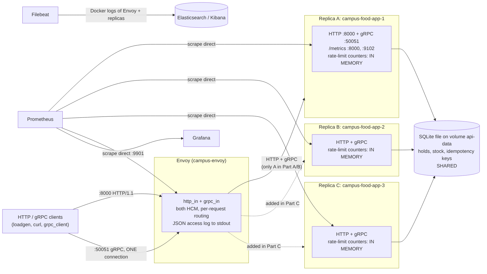

# Assignment 3: Load Balancing and Observability

Individual assignment, Enterprise Software Development, Fall 2026. Extends A2 (HTTP + gRPC `CreateHold`, metrics, logs).
Reused work: A1/A2 metrics, JSON logging, Filebeat/Elasticsearch/Kibana pipeline and the `hold_service` rules (see `docs/A2_REPORT.md`).
Everything marked **TODO(measure)** must be filled from your own runs; nothing below is a measured result.

## 1. Architecture and shared state

One container is one replica and runs both the HTTP server and the gRPC server (`campus_api/launcher.py`);
`docker compose up -d --scale app=3` creates `campus-food-app-1..3`, called A, B, C. Envoy is the only entry point
(HTTP `:8000`, gRPC `:50051`); replicas publish no host ports. Part A/B: both Envoy clusters list only A (B and C run,
idle). Part C onward: A, B, C. Prometheus scrapes A, B, C and Envoy directly by container name.

**Replica identity.** `REPLICA_ID` (A/B/C, derived from the Compose container index) appears in every app log line
(`replica`), in the `X-Replica` HTTP response header and `x-replica` gRPC initial metadata, and as the Prometheus
label `replica` (set in `prometheus.yml`). **Correlation:** Envoy keeps the client's `X-Request-ID` (or creates one)
and forwards it; the app already uses it as `request_id`. Filebeat copies both Envoy's and the app's id into one
`trace_id` field, so `trace_id : "<id>"` finds both events. Envoy logs the answering replica from the `x-replica` header.

| State | Where it lives | Shared by all replicas? | If requests are spread across replicas |
|---|---|---|---|
| Data (eateries, items, stock, holds) | one SQLite file on volume `api-data` | **Yes** (file lock serialises writers; stock decrement is one atomic `UPDATE`) | Consistent. Limits: single host, writers queue on the file lock; a real deployment would use a networked database. |
| Idempotency records | table `idempotency_keys`, same transaction as the hold (`BEGIN IMMEDIATE`) | **Yes** | A retry that lands on another replica still replays the original hold: no duplicate. Shown by `experiments/a3/shared_state_check.py`. |
| Rate-limit counters (`POST /holds`) | Python dict in each replica's memory | **No** | Each replica counts only its own share, so the effective limit is about N x `HOLD_RATE_LIMIT` (15 per window with 3 replicas, not 5) and the counters reset when a replica restarts. Fix: keep counters in a shared store (database/Redis) or rate-limit in Envoy. |
| Background job (expiry, daily reset) | runs in every replica | n/a | Made safe: both steps now take the write lock (`BEGIN IMMEDIATE`) before reading, so two replicas cannot expire the same hold twice or reset the menu twice. |
| Startup seeding | every replica calls `seed_if_empty` | n/a | Made safe the same way (otherwise three replicas starting together hit duplicate primary keys). |

Also changed for the proxy: the rate limiter keys on the last `X-Forwarded-For` entry (the address Envoy saw), because
behind Envoy every request otherwise comes from Envoy's own IP and all clients would share one bucket.
`/health` is no longer logged or counted, so Envoy's health checks do not pollute rate, share or logs.

**Test traffic.** HTTP: `GET /eateries/1/menu` (read-only). gRPC: `CreateHold` with one fixed idempotency key, so every
timed call is a replay (no new rows; A2 has no read-only RPC). One gRPC channel (one TCP connection) for the whole run.

## 2. Envoy configuration

Generated by `envoy/render.py` (stage flag, so each run's configuration is reproducible; the file header records it).
Both listeners use the HTTP connection manager (`codec_type: AUTO`), so each gRPC call is routed on its own although
the client keeps one connection; the gRPC cluster talks HTTP/2 upstream. Not `tcp_proxy`: that would pin the whole
connection to one replica. Retries: none (no `retry_policy`). Circuit breakers: limits raised to 100000 so Envoy's
defaults never trigger. No outlier detection. Policies: `ROUND_ROBIN`, weights via `load_balancing_weight`,
`LEAST_REQUEST` (default `choice_count` 2: Envoy compares two random replicas and picks the one with fewer active requests).

### Health-check settings (Part D3 only)

| Setting | Value |
|---|---|
| Check | HTTP `GET /health` on each replica's port 8000 (also used for the gRPC cluster; same container) |
| interval | 2 s |
| timeout | 1 s |
| unhealthy_threshold | 2 consecutive failures |
| healthy_threshold | 2 consecutive successes (a brand-new host needs only 1) |
| DNS refresh | 5 s |
| Expected removal | about 2 to 4 s after the replica stops (first failing check within 2 s, then one more) |
| Expected recovery | restart time of the app (a few s) plus 2 to 4 s of checks |

Limitation: the check proves the HTTP process answers; both processes share a container and the launcher exits if
either dies, so a half-alive replica does not stay in rotation. A slow replica still passes (the check only needs a
reply within 1 s), see D2.

## 3. Metrics and queries (dashboard `A3: Load balancing`)

Labels are bounded (`replica`, `method`, `route` template, `status`); no request, trace or item IDs. Rates and quantiles
use a **1 minute window**; scrape interval 5 s. Replica metrics come from each replica's own `/metrics`.

| Panel | Query (HTTP; gRPC uses `campus_grpc_*`, `status!="OK"`) |
|---|---|
| Request rate | `sum by (replica) (rate(campus_http_requests_total[1m]))` |
| Share of total | `100 * sum by (replica)(rate(...[1m])) / scalar(sum(rate(...[1m])))`, dashed line `vector(100/3)` |
| Active requests | `sum by (replica) (campus_http_requests_in_progress)` / `campus_grpc_requests_in_progress` |
| p50 / p95 | `histogram_quantile(q, sum by (le, replica) (rate(campus_http_request_duration_seconds_bucket[1m])))` |
| Errors by status | `sum by (replica, status) (rate(campus_http_requests_total{status!~"2.."}[1m]))` |
| Envoy row | `envoy_cluster_membership_healthy`, `envoy_http_downstream_rq_xx`, `envoy_cluster_upstream_rq_active`, `envoy_cluster_health_check_*` |

Caveats to state: server-side durations leave out network and Envoy time (client p95 is larger); histogram
quantiles snap to bucket edges; active requests is a gauge sampled every 5 s, so short bursts can be missed; requests
Envoy cannot deliver (replica down) never reach a replica, so those errors show only in the Envoy row and in client results.

## 4. Baselines

Workload: 50 rps for 60 s per interface (3000 requests), one run at a time, `experiments/a3/loadgen.py`.

**Part B, A only.** TODO(measure): `b-baseline-http`, `b-baseline-grpc`: rate, sent, successes, failures, client p95.
Dashboard screenshot (A = 100 %, B and C = 0 but up). Kibana: one `trace_id` search per interface returning the Envoy
and replica events (screenshots, include the ids). Expected: A 100 %, B and C idle.

**Part C, round robin.** TODO(measure): `c-rr-http`, `c-rr-grpc`; share per replica vs 33.3 %. Points to use when
explaining differences: Envoy keeps round-robin state per worker thread, and HTTP requests come over several
connections (hence several workers), so HTTP shares are close to, not exactly, 33.3 %; one gRPC connection is one
worker, so gRPC is nearly exact; 1 m rate windows and 5 s scrapes blur the edges of a run; the A-only baseline put
100 % on A and its p95 reflects one replica doing all the work. These are your round-robin baseline for Part D.

## 5. Experiments (prediction, observation, explanation; HTTP and gRPC separately)

Each starts from healthy round robin, same workload, restored afterwards. Predictions below are drafts: revise them
before the run and keep the revised version.

**D1 Weighted 2:1:1.** Prediction: shares 50/25/25 for both interfaces; at 50 rps nothing is saturated, so latency
barely changes; A's active requests are about double B's and C's. A higher weight sends more traffic, it adds no
capacity: if A were already near its limit its latency would rise. TODO(measure): shares, p95, active requests.

**D2 Delay on B (200 ms), round robin vs least request.** Prediction: round robin still sends B 33 %: its active
requests rise to about rate x share x delay = 50 x 0.33 x 0.2 = 3 and client p95 is about the delay (a third of the
calls are slow, so they set the 95th percentile). Least request: B's share falls well below 33 %, its active requests
stay low, and client p95 drops (some calls still reach B because only two random replicas are compared).
TODO(measure): B share, B active requests, client p95 for both runs. Note the health check still passes (200 ms < 1 s).

**D3 Failure and recovery.** Settings in section 2. Prediction: after `docker stop` B, requests routed to B fail
until it is removed (about 2 to 4 s): about 50 rps x 1/3 x 3 s = 50 failed requests, around 1 % of 4500; then A and C
take 50 % each; after `docker start` B returns after its start-up time plus the check thresholds. TODO(measure):
first and last failure time (`first_failure_at_s`, `last_failure_at_s` in the result JSON), removal and recovery time
from the "Healthy members" panel and `curl :9901/clusters`, redistribution chart, client errors by status. Compare
with interval x unhealthy_threshold and interval x healthy_threshold. Note Envoy keeps a host that has left DNS until it
fails its health check (default behaviour), so removal is governed by the checks, not by DNS.

### Summary table (`summarize.py` prints the rows)

| Run / interface | Policy and fault | Target / actual rps | A/B/C shares | Client p95 | Error rate | Explanation |
|---|---|---|---|---|---|---|
| TODO | | | | | | |

**Log check.** TODO(measure): for one run, the Envoy access-log distribution from Elasticsearch (the `envoy` line of
`summarize.py`, or Kibana visualisation of `envoy.replica` for the same time range) next to the Prometheus numbers.
Two proxy/backend log examples: one HTTP and one gRPC `trace_id` showing the Envoy event and the replica event.

## 6. Conclusions

1. **Strategy for HTTP and for gRPC.** TODO(your results). Frame: compare B's share, active requests and p95 between
   round robin and least request for each interface; recommend the policy that kept client p95 and errors lowest.
2. **A workload that would change the choice.** TODO. Candidates: very uniform, short requests (round robin is
   enough and cheaper to reason about); long-lived or streaming gRPC calls (per-call balancing no longer balances
   load, least request or connection limits matter); caching or session affinity (consistent hashing by item id).
3. **If Envoy stops.** Every client loses both interfaces: it is a single point of failure, though replicas and data
   stay intact. Improvement (not implemented): run two Envoy instances behind a virtual IP or DNS with health checks
   (keepalived, cloud load balancer), clients retry across both.

## 7. Limits and honesty notes

SQLite on one host is not a distributed database. The rate limiter is deliberately left per replica to show the
problem. TODO: credits and assistance statement as required by the course policy (tools used, what you wrote yourself).
