# Assignment 1: Observability — Campus Food Availability

## Part A: The project

**Problem.** At my university, when I buy food between classes I often ask the eatery to keep it
aside because I'm heading straight to a class, the gym, or swimming, and won't eat for another 2-3
hours. There's no way to see, before walking over, whether an eatery still has the item I want, and
no proper system for "keep this for me."

**Users.** Students on campus deciding where to eat and wanting to hold food for later; eatery staff
updating what's still available.

**Solution.** A FastAPI backend (`api/`) with three eateries (main cafeteria, coffee corner, grill
house) and their menus:

- `GET /eateries`, `GET /eateries/{id}/menu` — browse what's available right now.
- `POST /holds` — place a hold on an item (the actual pain point being solved);
  `POST /holds/{id}/pickup` and `.../cancel` close it.
- `PATCH /items/{id}/availability` — staff mark an item sold out or restock it (needs `X-Staff-Key`).
- A background job expires holds nobody picked up and resets the menu each morning.

**Reliability features added on top of the basics** (each has automated tests, see below):

- A single error format for every failure, including unknown routes. It always carries the
  `request_id`, so a user-visible error can be traced to its log lines (Figure A3).
- Rate limiting on hold creation: 5 requests per 10 seconds per client IP. Excess requests get HTTP
  429 with a `Retry-After` value; other endpoints are not affected.
- Idempotent hold creation through an `Idempotency-Key` header: repeating the same request with the
  same key creates one hold, and reusing a key with a different body is rejected with 422.
- An OpenAPI description of the API (`openapi.json`), validated with `openapi_spec_validator`
  (Figure A2).

**How to try it.** `docker compose up -d --build`, then Swagger UI at <http://localhost:8000/docs>.
Full instructions, including the correct ports for Prometheus (9091), Grafana (3001), Kibana (5602)
and Elasticsearch (9201), are in `README.md`.

**What works (evidence).**

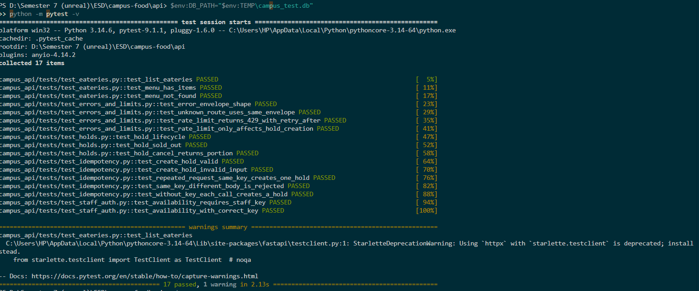

*Figure A1 — `python -m pytest -v` in `api/` (Python 3.14.6, pytest 9.1.1, Windows): 17 passed, 1
warning in 2.13 s. The tests cover eateries and menus, the hold lifecycle (create, sold-out
rejection, cancel returns the portion), the staff key, the error format, rate limiting (429 with
`Retry-After`, only on hold creation) and idempotency. The one warning is a Starlette deprecation
notice about `httpx` in the test client, not a failure.*

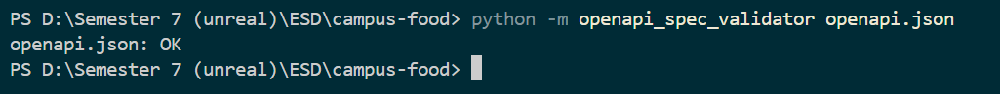

*Figure A2 — `python -m openapi_spec_validator openapi.json` prints `openapi.json: OK`.*

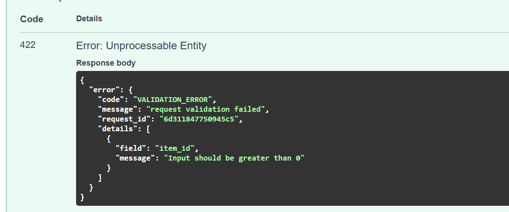

*Figure A3 — Sending `item_id` ≤ 0 to `POST /holds` returns HTTP 422 in the common error format. The
body names the field (`item_id`: "Input should be greater than 0") and includes
`request_id: 6d311847750945c5`. The same ID is written to the logs; Part C (Figure C2) shows that
trace for a 404 response.*

**Limitations (honest scope).** This is a local demo: Elasticsearch security is off, Grafana uses
`admin/admin`, the Prometheus admin API is enabled (only so Experiment E2 can clean up), and there is
no student login, so holds are not tied to a person.

---

## Part B: Metrics

Prometheus scrapes the app's `/metrics` endpoint every 5 seconds and Node Exporter for host stats;
Grafana queries Prometheus. Both are provisioned automatically by `docker compose up`
(`monitoring/grafana/provisioning/`, `monitoring/grafana/dashboards/app-and-business.json`).

The full metric list (purpose, type, unit, labels, where recorded) is in
[`docs/METRICS.md`](METRICS.md). The four types in use:

| Type | Used for |
|---|---|
| Counter | `campus_http_requests_total`, `campus_holds_placed_total`, and others — things that happened |
| Gauge | `campus_items_available`, `campus_active_holds`, `campus_http_requests_in_progress` — current state |
| Histogram | `campus_http_request_duration_seconds` (latency, all routes), `campus_hold_pickup_delay_seconds` (explored myself) |
| Summary | `campus_hold_creation_seconds` — average only; the Python client's Summary has no percentiles, so p95/p99 come from histograms |

### Targets: is everything being scraped?

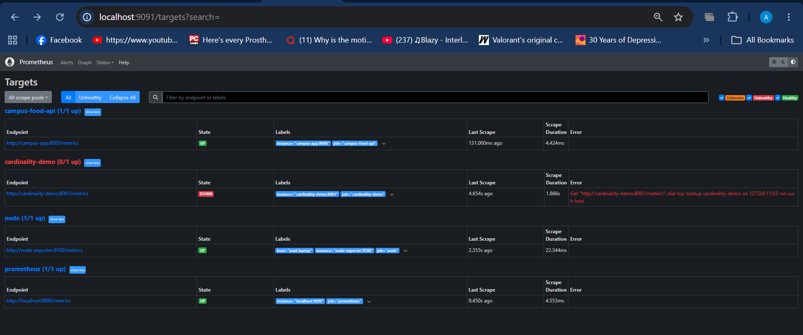

*Figure B1 — Prometheus → Status → Targets (<http://localhost:9091/targets>). `campus-food-api`
(`campus-app:8000`), `node` (`node-exporter:9100`, carrying the label `host="asad-laptop"`) and
`prometheus` itself are UP. `cardinality-demo` is DOWN on purpose: it only exists while Experiment E2
is running (`--profile experiments`).*

### Dashboard: panels, queries and what they show

Dashboard: **Campus Food: app, business & host metrics** (`monitoring/grafana/dashboards/app-and-business.json`).
The rate window is stated in each query. "p95" means the 95th percentile **over the trailing
5 minutes, per route**: "95% of requests in the last 5 minutes took this long or less." The one
exception is panel 10, which uses 30 minutes because pickups are rare.

| # | Panel | Type | Query | What it shows |
|---|---|---|---|---|
| 1 | Request rate by route | Counter | `sum by (route) (rate(campus_http_requests_total[1m]))` | Which endpoints are used. Routes use the template (`/holds/{hold_id}`), never the raw path, to keep cardinality bounded. |
| 2 | Error rate: 4xx / 5xx | Counter | `sum by (status) (rate(campus_http_requests_total{status=~"4..\|5.."}[1m]))` | Failed requests per second by status code. |
| 3 | Requests in progress | Gauge | `campus_http_requests_in_progress` | Concurrency right now; sits at 0 outside bursts. |
| 4 | p95 request latency by route | Histogram | `histogram_quantile(0.95, sum by (route, le) (rate(campus_http_request_duration_seconds_bucket[5m])))` | Slow-request tail per endpoint; the chart Experiment E1 moves. |
| 5 | Menu views by eatery | Counter (business) | `sum by (eatery) (rate(campus_menu_views_total[5m]))` | Which eatery students check. |
| 6 | Holds placed vs rejected | Counter (business) | `sum(rate(campus_holds_placed_total[5m]))`, `sum(rate(campus_holds_rejected_total[5m]))` | How often the hold feature is used and how often it fails (mostly sold-out). |
| 7 | Items available by eatery | Gauge (business) | `campus_items_available` | What a student would see as orderable right now. |
| 8 | Active holds by eatery | Gauge (business) | `campus_active_holds` | Food currently set aside. |
| 9 | Average hold-creation time | Summary | `rate(campus_hold_creation_seconds_sum[5m]) / rate(campus_hold_creation_seconds_count[5m])` | Mean time to create a hold (average only). |
| 10 | Hold pickup delay p50 / p95 | Histogram (explored myself) | `histogram_quantile(0.5, sum by (le) (rate(campus_hold_pickup_delay_seconds_bucket[30m])))` and the same with `0.95` | How long food really waits before the student returns, over a 30-minute window. |
| 11 | Staff auth failures | Counter | `rate(campus_staff_auth_failures_total[5m])` | Wrong or missing staff key attempts per second. |
| 12 | Background job last-run age | Gauge | `time() - campus_background_job_last_run_timestamp_seconds` | Seconds since the job last finished; a rising line means it stopped. |
| 13 | Node: CPU busy % | Node Exporter | `100 - (avg by (host) (rate(node_cpu_seconds_total{mode="idle",host="asad-laptop"}[5m])) * 100)` | CPU use of the measured machine. |
| 14 | Node: memory used % | Node Exporter | `100 * (1 - node_memory_MemAvailable_bytes{host="asad-laptop"} / node_memory_MemTotal_bytes{host="asad-laptop"})` | Memory pressure. |
| 15 | Node: disk free % | Node Exporter | `100 * node_filesystem_avail_bytes{host="asad-laptop", mountpoint=~"/mnt/host/d\|/var/lib"} / node_filesystem_size_bytes{host="asad-laptop", mountpoint=~"/mnt/host/d\|/var/lib"}` | Free space on the Windows D: drive and on Docker's own virtual disk. |
| 16 | Node: network throughput | Node Exporter | `rate(node_network_receive_bytes_total{host="asad-laptop",device!="lo"}[5m])` and the `node_network_transmit_bytes_total` equivalent | Bytes per second in and out on the non-loopback interface. |

**Application and request panels (1–6).**

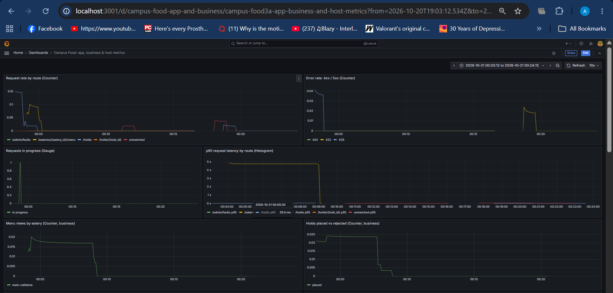

*Figure B2 — Dashboard, 2026-10-21 00:03 to 00:24 (browser time). Panels 1–6. Request rates in this
window are low (at most about 0.15 req/s per route) because this was manual testing; the 5 req/s load
runs are separate. Panel 2 shows only 4xx codes (404, 422, 429) and no 5xx in this window. The p95
panel's long plateau near 4.8 s is explained in the box below.*

> **Reading the p95 plateau (≈4.8 s).** `histogram_quantile` does not know exact latencies; it only
> knows how many requests fell into each bucket and interpolates inside the bucket that contains the
> percentile. My buckets are …, 1.0, 2.5, 5.0 seconds. If *all* observations in the window land in the
> 2.5–5 s bucket, the 95th percentile is interpolated to 2.5 + 0.95 × 2.5 ≈ 4.9 s, whatever the real
> latency inside that bucket was (it could be 3 s). So a flat line near 4.8 s means "everything was
> between 2.5 s and 5 s", not "exactly 4.8 s". With very few requests per window (≈0.1/s here) the
> estimate is also noisy.
>
> **Cause.** The plateau comes from a 3000 ms menu delay that I set through the fault switch
> (`menu_delay_ms: 3000`) during a manual test at about 00:04 local time. Kibana shows three
> `fault_injected` events with `app.delay_ms: 3000` in that period. Those few slow requests made up
> most of the menu route's observations in the window, which is why the whole p95 sits in the
> 2.5–5 s bucket. The line drops to near zero once the fault was removed (about 00:08).

**State and slower panels (7–12).**

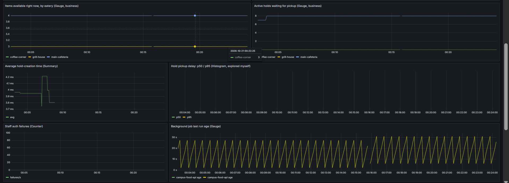

*Figure B3 — Panels 7–10, 14:15 to 14:45, 2026-10-25 (local time). Items available stay at 3–4 per
eatery. Active holds jump to 4 at about 14:40 and fall back to 0 by 14:44, as the demo holds are picked up (see the explored metric below). Average hold-creation time is about 6–10 ms (Summary: average only).
The bottom-right panel is the explored metric: the p50 and p95 of hold pickup delay, which only
appear once pickups have happened. Panels 11–12 (staff auth failures, background job age) are in
Figure D2.*

**Known cosmetic issue (panel 12).** The two lines are both labelled "campus-food-api age". The
metric's own `job` label (the background job's name) clashes with Prometheus's scrape `job` label, so
Prometheus renames it to `exported_job`, and the legend (which uses `job`) shows the scrape job twice.
Using `{{exported_job}}` in the legend, or renaming the metric label (for example to `task`), would fix it.

**Host panels (13–16) — Node Exporter, machine `asad-laptop`.**

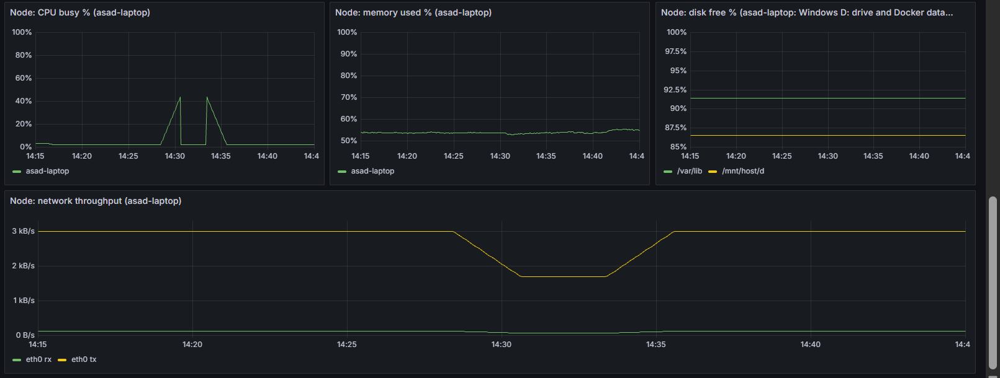

*Figure B4 — Node Exporter panels for `asad-laptop`, 14:15 to 14:45 local time, 2026-10-25. CPU is
near 0 % apart from two bursts to about 40 %, memory used is about 53–55 %, the disk panel shows two
lines (about 91 % and 86 % free, for `/var/lib` and `/mnt/host/d`), and network rx/tx on `eth0` is in
kB/s.*

The Node panels also reacted to events from this session, which shows they measure something real.
The CPU burst at about 14:30 matches Prometheus being restarted (replaying its write-ahead log), and
the one at about 14:33 matches rebuilding the `api` container. The transmit line falls from about
3 kB/s to about 1.7 kB/s between 14:28 and 14:35 and then recovers. That is the period of the
Prometheus outage in Part D, and it fits the explanation that a large share of the baseline traffic on
`eth0` is Prometheus scraping the exporters every 5 s, so when scraping stopped the traffic dropped.
The dip lasting a few minutes after the restart matches the 5-minute rate window in the panel's query.

**What `asad-laptop` actually is.** Node Exporter runs in a container inside Docker Desktop's WSL2
virtual machine (the kernel shows up in the mount list as `6.18.54.1-microsoft-standard-WSL2`), so
CPU, memory and network are those of that Linux VM on my laptop, not of Windows itself. Its
`/mnt/host/c` and `/mnt/host/d` mounts (filesystem type `9p`) are the Windows C: and D: drives. The
roughly constant 3 kB/s on `eth0` is probably mostly Prometheus's own 5 s scraping.

**Disk panel.** The first version filtered on `mountpoint="/"`, which does not exist from inside the
exporter's container, hence "No data". `node_filesystem_avail_bytes{host="asad-laptop"}` lists dozens of
mounts; the two that mean something for this project are `/mnt/host/d` (the Windows D: drive, where the
project lives) and `/var/lib` (ext4 on `/dev/sdg`, the virtual disk that holds Docker's images and
volumes). The panel now uses the query in the table above with legend `{{mountpoint}}`.

### The metric I explored myself: hold pickup delay

`campus_hold_pickup_delay_seconds` is a Histogram recorded in `routers/holds.py: pick_up()`. It
observes the seconds between `POST /holds` and `POST /holds/{id}/pickup`. None of the course examples
cover "how long does a customer actually wait", but it is the number that matters most for this app:
it shows whether people really come back after 2-3 hours, or whether most holds are collected in 20
minutes (which would mean the feature solves a smaller problem than intended) or never collected
(food wasted). Percentiles come from `histogram_quantile` over the buckets.

**Buckets and the demonstration.** The buckets were first 10 min, 30 min, 1 h, 2 h, 3 h, 4 h, 6 h and
12 h, which suit real use (students come back after 2–3 hours) but are useless for a demonstration:
every pickup within 10 minutes would land in the first bucket and `histogram_quantile` would only
interpolate inside it (p50 ≈ 5 min, p95 ≈ 9.5 min whatever the real delays). I added 30 s, 60 s, 120 s
and 300 s, so the buckets are now 30 s, 1 min, 2 min, 5 min, 10 min, 30 min, 1 h, 2 h, 3 h, 4 h, 6 h
and 12 h.

To populate the panel I created five holds (IDs 446–450), 5 s apart, and picked each up after 15, 30,
60, 120 and 240 s; all five returned HTTP 200. Figure B3 shows p50 of about 40 s and p95 of about
2 minutes while the pickups were still arriving. Once all five were done,
`histogram_quantile(0.95, sum by (le) (rate(campus_hold_pickup_delay_seconds_bucket[10m])))` returned
277.5 s. That is what the buckets predict: the 95th percentile is observation 4.75 of 5, inside the
2–5 minute bucket that holds the last two observations, so 120 + (4.75 − 3) / 2 × 180 = 277.5 s. It is
higher than the real maximum of 240 s because the histogram interpolates inside the bucket. With the
old 10-minute lowest bucket these values could not appear, so the bucket change took effect.

---

## Part C: Logs

**What is logged, and why.** Every log line is one JSON object with `time`, `service`, `severity`,
`message`, and `request_id` when inside a request (`api/campus_api/observability/logs.py`). Events,
each with the fields needed to investigate it without opening the code:

- `request_completed` — every HTTP request: method, path, route template, status, duration.
- `hold_created`, `hold_picked_up`, `hold_cancelled`, `hold_rejected`, `holds_expired`.
- `hold_replayed` — a repeated hold request answered from its `Idempotency-Key`.
- `rate_limited` — a request refused with 429 (fields: `client`, `retry_after`).
- `availability_changed` — staff updates.
- `staff_auth_failed` — wrong or missing key (never logs the key itself).
- `fault_configured`, `fault_injected`, `fault_cleared` — Experiment E1's switch and its effects.
- `unhandled_exception` — full stack trace for anything not handled explicitly.

**No secrets or personal data.** There is no login system, so there is no password or personal
identifier to log. The staff-key check logs only that a key was missing or wrong, never its value
(`auth.py: require_staff()`). The request ID is a random hex string, not tied to a person.

**How Filebeat collects and parses logs** (`monitoring/filebeat/filebeat.yml`):

```
app writes one JSON line to stdout
  -> Docker's json-file driver wraps it and writes it to
     /var/lib/docker/containers/<id>/<id>-json.log
  -> Filebeat's container input tails that file
  -> add_docker_metadata attaches the container name; events not from
     "campus-app" are dropped
  -> decode_json_fields parses the app's JSON string into real fields under "app.*"
  -> the timestamp processor uses app.time as @timestamp (event time, not read time)
  -> output.elasticsearch writes it to campus-food-logs-YYYY.MM.DD
```

**Three formats of one log line.** The example is the `hold_created` event of request `e1-baseline-0`,
the first request of the E1 baseline stage (2026-10-24, 11:36:39.133 UTC).

1. *The original line the app prints to stdout.* Elasticsearch keeps an unchanged copy of it as
   `event.original`, so it can be shown exactly:

```json
{"time": "2026-10-24T11:36:39.133Z", "service": "campus-food-api", "severity": "INFO", "message": "hold 321 created", "request_id": "e1-baseline-0", "event": "hold_created", "hold_id": 321, "item_id": 2, "eatery": "main-cafeteria", "planned_pickup_minutes": 180}
```

2. *Docker's wrapper (what Filebeat actually reads).* One line of
   `/var/lib/docker/containers/<id>/<id>-json.log`, found with
   `MSYS_NO_PATHCONV=1 docker exec campus-filebeat sh -c "grep -h -m1 e1-baseline-0 /var/lib/docker/containers/*/*-json.log"`:

```json
{"log":"{\"time\": \"2026-10-24T11:36:39.133Z\", \"service\": \"campus-food-api\", \"severity\": \"INFO\", \"message\": \"hold 321 created\", \"request_id\": \"e1-baseline-0\", \"event\": \"hold_created\", \"hold_id\": 321, \"item_id\": 2, \"eatery\": \"main-cafeteria\", \"planned_pickup_minutes\": 180}\n","stream":"stdout","time":"2026-10-24T11:36:39.134004931Z"}
```

   Docker adds three fields: `log` (the app's whole line as an escaped string ending in `\n`),
   `stream` (`stdout`) and its own `time`, which is 1 ms after the app's. Because the app's JSON is
   escaped inside a string, it is not searchable as fields until Filebeat's `decode_json_fields`
   parses it.

3. *The document stored in Elasticsearch* (`curl -s "localhost:9201/campus-food-logs-*/_search?q=app.event:hold_created&size=1&pretty"`;
   the query matched 240 `hold_created` documents across the daily indices, and the first hit's
   `_source` is shown, with Filebeat's remaining metadata fields left out):

```json
{
  "_index": "campus-food-logs-2026.10.24",
  "_source": {
    "@timestamp": "2026-10-24T11:36:39.133Z",
    "app": {
      "planned_pickup_minutes": 180,
      "severity": "INFO",
      "request_id": "e1-baseline-0",
      "hold_id": 321,
      "item_id": 2,
      "eatery": "main-cafeteria",
      "time": "2026-10-24T11:36:39.133Z",
      "service": "campus-food-api",
      "event": "hold_created"
    },
    "message": "hold 321 created",
    "event": { "original": "{\"time\": \"2026-10-24T11:36:39.133Z\", ... \"planned_pickup_minutes\": 180}" },
    "container": {
      "id": "79ae7086d15934fdc442a88fd10b961d85660ee35a92f0f55375e032dd4450ad",
      "name": "campus-app",
      "image": { "name": "campus-food-api" }
    },
    "stream": "stdout"
  }
}
```

What changed between the formats:

- **The JSON string became real fields.** Everything the app wrote now sits under `app.*`, with
  types: `hold_id` and `item_id` are numbers (so range searches work), `eatery` and `event` are
  exact-match keywords.
- **`@timestamp` is the event time.** It equals `app.time` (11:36:39.133Z), the moment the app logged
  the line, not the moment Filebeat read it.
- **Container context was added** (`container.name: campus-app`, the container ID and image name).
  This is also what lets Filebeat drop logs from every other container.
- **The Docker wrapper is mostly gone.** The raw `log` string and Docker's own `time` are not stored,
  because the parsed fields replace them. `stream: "stdout"` is kept, which tells stdout from stderr.
- **The original line is preserved** as `event.original`. Elasticsearch reports it in `_ignored`
  (`event.original.keyword`): the line is too long to be indexed as an exact-match keyword, so it can
  be read and full-text searched but not aggregated on. The parsed `app.*` fields are the ones to
  search and chart.
- **The message is promoted** to the top-level `message` field, which is the column Kibana shows by
  default.

**Fields Elasticsearch stores (seen in Kibana, Figure C1).** `app.eatery`, `app.event`, `app.hold_id`,
`app.item_id`, `app.method`, `app.new_status`, `app.path`, `app.planned_pickup_minutes`,
`app.portions_left`, `app.reason`, `app.request_id`, `app.retry_after`, `app.route`, `app.service`,
`app.severity`, `app.status`, plus the fault settings `app.menu_delay_ms`, `app.menu_delay_every_nth`
and `app.hold_fail_every_nth`. Text values are keywords (exact match) and counts or durations are
numbers, so range searches such as `app.duration_ms >= 400` work.

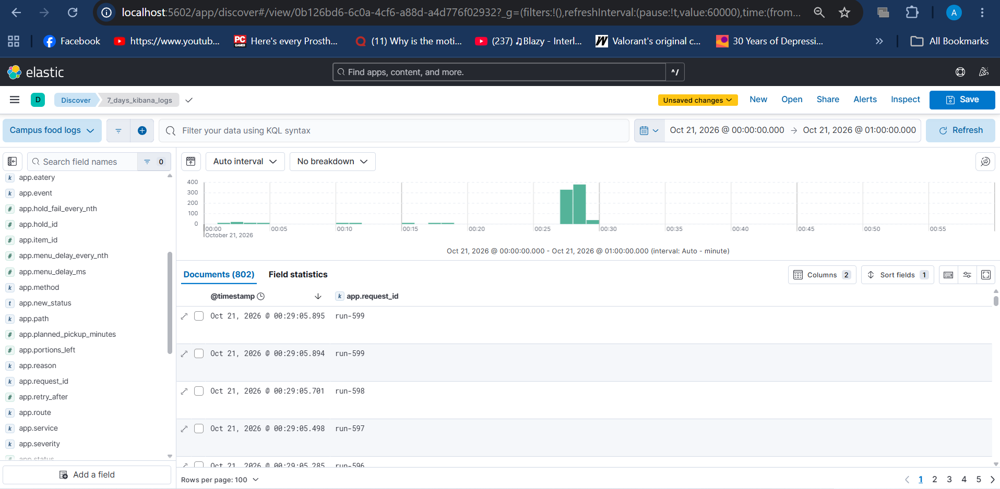

*Figure C1 — Kibana Discover, data view "Campus food logs", 2026-10-21 00:00–01:00: 802 documents.
The histogram shows a burst of roughly 330 log events per minute at about 00:27–00:29. The request
IDs in the table (`run-599`, `run-598`, …) match a 2-minute run at 5 req/s (600 requests, IDs
`run-0` to `run-599`) with the load generator's default tag `run`. The field list on the left is the
set of fields Filebeat extracted from the JSON.*

**Searching for one request.** The `request_id` is returned to the client in the `X-Request-ID` header
and in every error body (Figure A3), so a request seen in the browser or in `curl -i` can be traced
straight to its log lines.

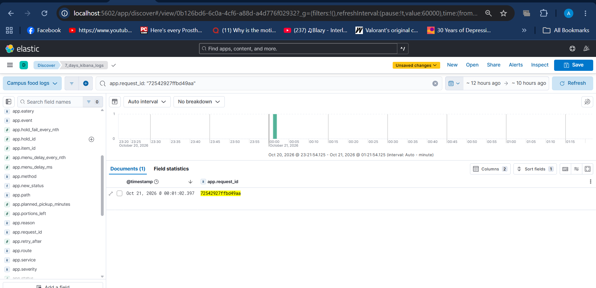

*Figure C2 — Searching `app.request_id: "72542927ffbd49aa"` returns exactly one document. It is the
log line of the 404 that `curl -i localhost:8000/holds/9999` returned with that same ID in its body and
in its `x-request-id` header: `app.event: request_completed`, `app.status: 404`,
`app.route: /holds/{hold_id}`, `app.duration_ms: 2.8`, logged at 2026-10-21 00:01:02.397 local time
(19:01:02.397Z).*

**Saved searches** (created by `monitoring/kibana/setup.sh`):

- "Errors and warnings": `app.severity : (ERROR or WARNING)`
- "5xx responses": `app.event : request_completed and app.status >= 500`
- "Holds rejected as sold out": `app.event : hold_rejected and app.reason : sold_out`
- "Requests slower than 400 ms": `app.event : request_completed and app.duration_ms >= 400`
- "Injected fault events": `app.event : fault_injected`

**Where logs live, what survives restarts, when they are deleted.**

| Where | What survives | Deleted when |
|---|---|---|
| Container stdout → Docker file `/var/lib/docker/containers/<id>/` | Survives `docker restart`. **Lost** when the container is recreated (`docker compose up --build`, `down`). | Rotated at 10 MB × 3 files (`logging:` in `docker-compose.yml`), so the oldest data is overwritten. |
| Filebeat registry (`filebeat-data` volume) | Survives restarts and `down`; Filebeat resumes where it stopped instead of re-reading everything. | `docker compose down -v`. |
| Elasticsearch daily indices `campus-food-logs-YYYY.MM.DD` (`es-data` volume) | Survives restarts and `down`. This is the long-term copy. | An ILM policy deletes each index 7 days after its creation (`min_age` is counted from index creation); also on `down -v`. |

**Real index listing** (`curl -s "localhost:9201/_cat/indices/campus-food-logs-*?v&s=index"`), taken
on 2026-10-24:

```
health status index                       pri rep docs.count store.size
green  open   campus-food-logs-2026.10.20   1   0       1582      767kb
green  open   campus-food-logs-2026.10.21   1   0         28     78.2kb
green  open   campus-food-logs-2026.10.23   1   0        424    349.4kb
green  open   campus-food-logs-2026.10.24   1   0       2319    930.7kb
```

One index per day, named by UTC date. There is no `2026.10.22` index because no log lines were
written that day. The Oct 20 and 21 indices will be deleted by the 7-day policy about a week after
they were created.

**The retention policy** is created by `monitoring/elasticsearch/setup.sh`. It is called
`campus-food-logs`, and its delete phase is `"delete": { "min_age": "7d", "actions": { "delete": {} } }`,
so each daily index is deleted 7 days after its creation. There is no hot, warm or rollover phase,
which is enough for one small index per day.

---

## Part D: System design

### 1. Architecture

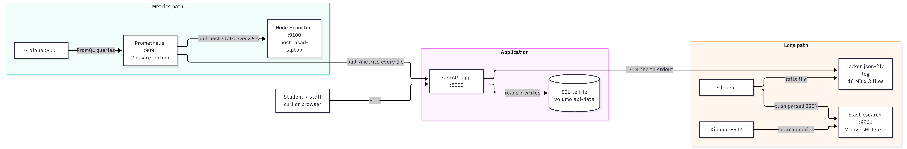

*Figure D1 — Architecture. The client talks to the FastAPI app over HTTP; the app stores data in
SQLite. Prometheus **pulls** metrics from the app and Node Exporter every 5 s and Grafana queries
Prometheus. For logs, the app writes JSON to stdout, Docker stores it in a file, and Filebeat reads
that file and **pushes** the parsed events to Elasticsearch, which Kibana searches.*

| Component | What it does and why | If it stops |
|---|---|---|
| FastAPI app | Handles requests, updates SQLite, exposes `/metrics`, writes JSON logs to stdout. | Students see connection errors. Data is safe (SQLite is on a volume). No metrics or logs while down; Prometheus shows the target DOWN. |
| SQLite (`api-data`) | One file; a single-writer app with modest traffic does not need a database server. | Holds and menu state are lost only if the volume is deleted (`down -v`). |
| Prometheus | Pulls `/metrics` every 5 s, stores locally, 7-day retention. | The app keeps working; Grafana has a gap for that period; nothing before it is lost. |
| Node Exporter | Exposes host CPU, memory, disk and network. | Host panels go empty; app panels unaffected. |
| Grafana | Only queries Prometheus; stores no metrics. | Dashboards reappear (provisioned from files) when it restarts. |
| Filebeat | Reads Docker log files and the Docker socket (for container names); keeps its read position in a volume. | Logs keep accumulating in Docker's file (up to the rotation limit) and are shipped when it returns. |
| Elasticsearch | Stores parsed logs, one index per day, deleted after 7 days. | Filebeat retries; the Docker file is the buffer, bounded by 10 MB × 3 rotation. Longer outages lose the oldest lines. |
| Kibana | Read-only search UI. | No effect on data. |

**Measured failure test: Prometheus stopped for about 2 minutes (2026-10-25).**

```bash
date -u +%T                                   # 09:28:25
docker compose stop prometheus
for i in $(seq 1 6); do curl -s -o /dev/null -w "%{http_code} " localhost:8000/eateries; sleep 20; done; echo
date -u +%T                                   # 09:30:27
docker compose start prometheus
```

Output of the six requests: `200 200 200 200 200 200`. The app answered every request while
Prometheus was down, so users saw no effect. What is lost is the monitoring during that window
(09:28:25–09:30:27 UTC, 14:28–14:30 local). The app keeps counting in the meantime, so once Prometheus
is back its next scrape picks up counter totals that already include the six requests; only the detail
inside the outage is lost.

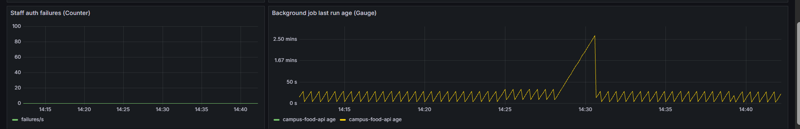

*Figure D2 — "Staff auth failures" and "Background job last run age", last 30 minutes, 2026-10-25
(local). The job-age panel normally shows a sawtooth that climbs to about 30 s and resets, so the job
runs roughly every 30 s. From about 14:28 the line climbs in a straight ramp to about 2.6 minutes and
snaps back to the normal sawtooth at about 14:30:30, exactly the length of the outage plus one scrape.*

Reading the picture: the panel does not go blank. The query is `time() - campus_background_job_last_run_timestamp_seconds`,
and while Prometheus has no new samples, PromQL keeps using the last stored value (it looks back up to
5 minutes), so `time()` advances and the "age" grows. To someone looking at the dashboard, the background job
appears to have stalled for 2.5 minutes when in fact the job kept running and only the monitoring was
down. Once Prometheus returned, the next scrape showed a fresh timestamp and the age dropped back to
normal. Panels that use `rate()` over a short window (such as the request-rate panels) go blank
during an outage, and plain gauge panels (items available, active holds) stay flat at their last
value. The lesson for the design is that an alert on "job age" should also check that Prometheus is
scraping (`up`), or it will raise a false alarm during a monitoring outage.

### 2. Following one metric and one log

**Metric — `campus_holds_placed_total`.** I placed one hold on item 4 (`POST /holds`) and read the
same counter at every hop, before and after.

1. *Code:* `HOLDS_PLACED.labels(item["eatery"]).inc()` in `routers/holds.py: create_hold()`, right
   after the hold is committed.
2. *Exposition:* the app's `/metrics` endpoint shows the counter.
3. *Collection:* Prometheus scrapes `campus-app:8000` every 5 s (Figure B1 shows the target UP) and
   stores each scrape as a sample on the series
   `{eatery="main-cafeteria", instance="campus-app:8000", job="campus-food-api"}`.
4. *Query and display:* Grafana's "Holds placed vs rejected" panel runs
   `sum(rate(campus_holds_placed_total[5m]))` and refreshes every 10 s.

| Hop | Where | Before | After |
|---|---|---|---|
| Code | `HOLDS_PLACED.labels(item["eatery"]).inc()` in `routers/holds.py: create_hold()` | n/a | ran once |
| App `/metrics` | `curl.exe -s localhost:8000/metrics \| Select-String campus_holds_placed` | `5.0` | `6.0` |
| Prometheus | Table view of `campus_holds_placed_total` (`localhost:9091`) | `5` | `6` |
| Grafana | "Holds placed vs rejected": `sum(rate(campus_holds_placed_total[5m]))` | `0` | about `0.0033` |

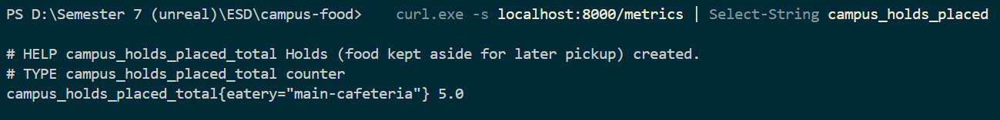

*Figure D3a — `/metrics` before the extra hold: `campus_holds_placed_total{eatery="main-cafeteria"} 5.0`.*

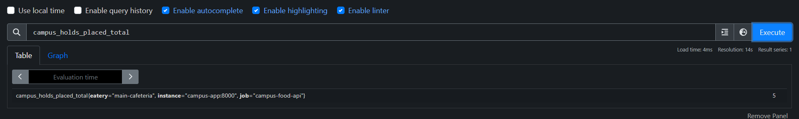

*Figure D3b — Prometheus Table view before: value 5.*

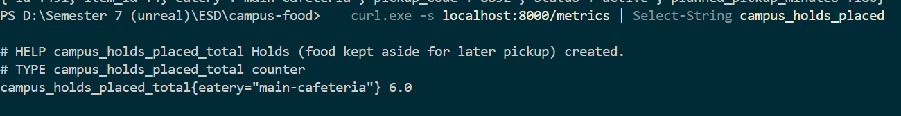

*Figure D3c — `/metrics` after the hold: the counter is 6.0.*

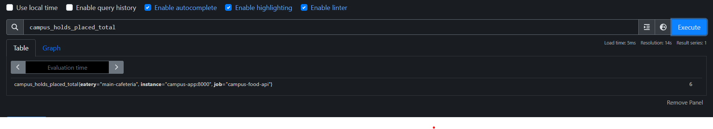

*Figure D3d — Prometheus Table view after: value 6.*

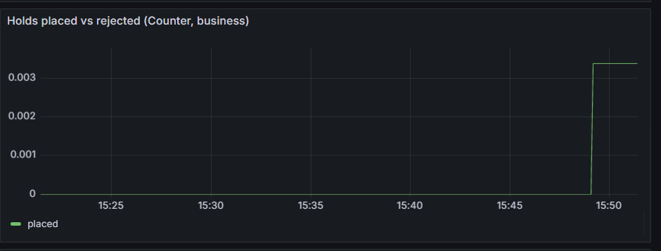

*Figure D3e — Grafana panel "Holds placed vs rejected" stepping up when the hold was placed.*

The counter went from 5 to 6, and Prometheus shows the new value within one 5-second scrape. The
Grafana panel shows a rate, not the counter itself: one extra hold inside the 5-minute window is
1 / 300 s ≈ 0.0033 holds per second, which is the step on the chart. The line returns to 0 once the
hold is more than 5 minutes old. Only `placed` is drawn because no hold was rejected in that window.

**Log — `hold_created`:**

1. *Code:* the same function calls `log_event(logger, logging.INFO, "hold_created", ...)`, which
   writes one JSON line to stdout.
2. *Docker:* wraps the line and appends it to `<id>-json.log` (format 2 in Part C).
3. *Filebeat:* tails the file, drops it if the container is not `campus-app`, runs `decode_json_fields`
   so the JSON string becomes fields (`app.event: "hold_created"`, `app.hold_id: 2`, …), sets
   `@timestamp` from `app.time`, and drops the raw `log` string (`stream: stdout` stays).
4. *Elasticsearch:* stores the document in `campus-food-logs-YYYY.MM.DD`.
5. *Kibana:* `app.event : "hold_created"` in Discover returns it with `hold_id` and `eatery` as
   columns.

The same hold (hold 321, request `e1-baseline-0`) is followed through all three formats in Part C.

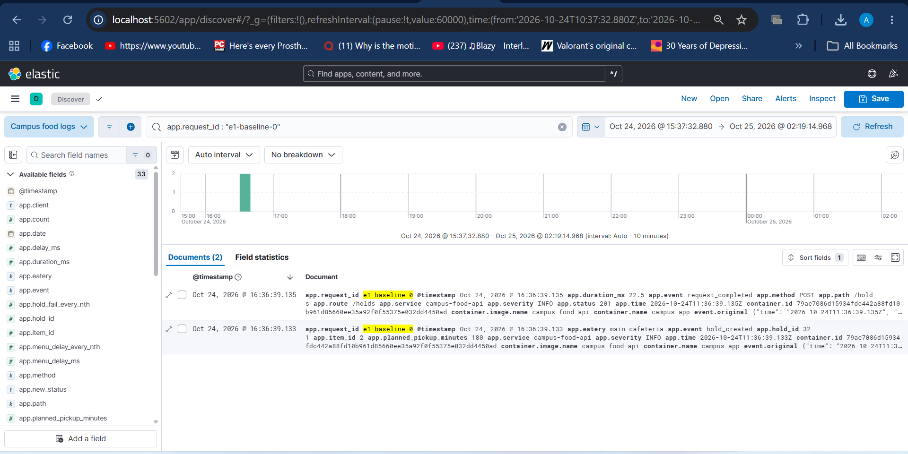

*Figure D4 — Searching `app.request_id : "e1-baseline-0"` returns two documents: `hold_created`
(hold 321, 16:36:39.133 local) and the `request_completed` line for the same `POST /holds` request
2 ms later (status 201, `app.duration_ms` 22.5). The log written by the code at the start of this
path is the one found at the end of it, with its fields searchable.*

### 3. What I do not yet understand

Working on this stack was interesting, but a few things are still unclear to me:

- **Prometheus storage lifecycle.** I do not understand how Prometheus manages the head block and the
  write-ahead log (WAL), how compaction works, or when exactly series are dropped from memory. Part E2
  shows the visible effect (old series stay in `prometheus_tsdb_head_series` after the label is
  removed), but not the mechanism behind it.
- **How wrong a histogram p95 can be.** I know that `histogram_quantile` interpolates inside a bucket
  (Figure B2 and E1: 877 ms estimated against 524.8 ms measured by the client). What I cannot yet do
  is work out in advance how large the error will be for a given choice of bucket edges.
- **Elasticsearch dynamic mapping.** I am not sure how Elasticsearch decides the type of each new
  field, or what happens when a field's type differs between daily indices.
- **Filebeat queues.** I do not know what Filebeat does internally with its queue and registry when
  Elasticsearch or Filebeat itself goes down, beyond the behaviour described in the table above.

---

## Part E: Experiments

Both scripts print the UTC start and end of every stage; use those for the Grafana time range and the
Kibana time filter. Screenshots in this section use absolute time ranges.

### E1: slow menu requests during a simulated rush

**Why this problem.** For a food app, the menu is the most-used screen. A tail of slow menu loads is
the realistic failure: nothing errors, but some students wait.

**Method** (`experiments/e1_slow_menu.sh`; run in Git Bash on Windows). Three stages at 5 requests/s
from `experiments/traffic.py` (deterministic with `--seed`; mix of 60 % menu reads, 15 % item reads,
14 % new holds, 6 % pickups, 2 % cancels, 3 % staff updates). Each stage ran for 120 s (24 Prometheus
scrapes at 5 s), back to back; the script printed the UTC boundaries (see Results).

| Stage | Tag | Action |
|---|---|---|
| 1 Baseline | `e1-baseline` | `DELETE /admin/faults`, then `python experiments/traffic.py --tag e1-baseline --duration 120 --rps 5` |
| 2 Fault | `e1-fault` | `POST /admin/faults {"menu_delay_ms": 500, "menu_delay_every_nth": 5}` (adds 500 ms to every 5th `GET /eateries/{id}/menu`), same traffic with tag `e1-fault` |
| 3 Recovery | `e1-recovery` | `DELETE /admin/faults`, same traffic with tag `e1-recovery` |

**Prediction (before running).**

- Only `GET /eateries/{id}/menu` changes; the other routes stay as they were.
- 20 % of menu requests become about 0.503 s. My histogram has a bucket edge at 0.5 s and the next at
  1.0 s, so those requests fall in the (0.5, 1.0] bucket.
- *Menu p95:* the fastest 80 % are below about 25 ms. The 95th percentile is 75 % of the way through
  the slow 20 % (since (0.95 − 0.80) / 0.20 = 0.75), so `histogram_quantile` interpolates to
  0.5 + 0.75 × 0.5 ≈ **0.875 s**, not 0.5 s. The real worst-case latency is about 0.5 s; the chart
  overstates it because of bucket width.
- *Menu mean:* 0.8 × ~5 ms + 0.2 × ~503 ms ≈ **100 ms**.
- *Share of menu requests at or under 0.5 s:* about **80 %** during the fault, about **100 %**
  otherwise.
- *Logs:* one `fault_injected` warning per delayed request, so about 0.6 × 5 rps ÷ 5 = **0.6 per
  second** (about 72 in a 120 s stage).
- No change in status codes or error rate.

**Queries to chart (menu route only, 1-minute window, so stages are visible):**

```promql
# p95
histogram_quantile(0.95, sum by (le) (rate(campus_http_request_duration_seconds_bucket{route="/eateries/{eatery_id}/menu"}[1m])))
# mean
sum(rate(campus_http_request_duration_seconds_sum{route="/eateries/{eatery_id}/menu"}[1m]))
  / sum(rate(campus_http_request_duration_seconds_count{route="/eateries/{eatery_id}/menu"}[1m]))
# share at or under 0.5 s
sum(rate(campus_http_request_duration_seconds_bucket{route="/eateries/{eatery_id}/menu", le="0.5"}[1m]))
  / sum(rate(campus_http_request_duration_seconds_count{route="/eateries/{eatery_id}/menu"}[1m]))
```

Kibana: `app.event : "fault_injected"` for the fault stage, and
`app.event : "request_completed" and app.duration_ms >= 400` for the slow requests themselves.

> **Why 1 minute and not the dashboard's 5?** With `[5m]`, a 2-minute stage barely moves the line and
> the "recovery" stage keeps looking slow for about 5 minutes after the fault is cleared, because the
> window still contains fault data. That is a property of the window, not of the app.

**Results** (measured on the Docker stack, run in Git Bash on 2026-10-24, about 16:36–16:42 local time
(UTC+5); times below are UTC as printed by `e1_slow_menu.sh`). The first set of numbers is measured by
the load generator (`traffic.py`) on the client side. The server-side view (Prometheus, Kibana) follows.

Menu route, `GET /eateries/{id}/menu`:

| Stage | UTC window | Requests | Menu requests | Menu mean | Menu p95 |
|---|---|---|---|---|---|
| Baseline (`e1-baseline`) | 11:36:38 – 11:38:39 | 595 | 346 | 14.4 ms | 28.5 ms |
| Fault (`e1-fault`) | 11:38:39 – 11:40:39 | 595 | 346 | **113.8 ms** | **524.8 ms** |
| Recovery (`e1-recovery`) | 11:40:39 – 11:42:40 | 594 | 346 | 13.3 ms | 28.7 ms |

Other routes (mean / p95, ms), which should not change:

| Route | Baseline | Fault | Recovery |
|---|---|---|---|
| item | 14.7 / 27.8 | 13.4 / 29.1 | 11.6 / 28.1 |
| hold (create) | 17.6 / 35.8 | 17.4 / 34.9 | 20.2 / 35.3 |
| pickup | 20.8 / 31.6 | 19.2 / 35.0 | 18.7 / 34.7 |
| cancel | 14.7 / 38.1 | 13.4 / 25.3 | 13.5 / 25.4 |
| staff update | 22.2 / 33.7 | 16.9 / 29.6 | 17.3 / 32.2 |

Status codes: baseline `{200: 508, 201: 42, 409: 8, 429: 37}`, fault `{200: 508, 201: 42, 409: 7,
429: 38}`, recovery `{200: 507, 201: 41, 409: 7, 429: 39}`. The fault switch state before, during and
after was `{"menu_delay_ms":0,...}`, `{"menu_delay_ms":500,"menu_delay_every_nth":5,...}`,
`{"menu_delay_ms":0,...}`, as returned by `/admin/faults`.

What this shows:

- **Repeatable.** The same seed produced the same traffic in all three stages: 346 menu, 96 item and
  87 hold requests each time. Only pickup and cancel counts differ by one or two, because they depend
  on which holds exist at that moment.
- **Prediction confirmed.** Only the menu route changed: mean 14.4 → 113.8 ms (about 8×) and p95
  28.5 → 524.8 ms (about 18×). Every other route stays within normal run-to-run noise (a few ms).
  The fault-stage mean is a little above my ≈100 ms estimate because the generator's timing includes
  about 14 ms of client and network overhead on every request (the baseline mean).
- **The p95 is the delay itself.** With 20 % of menu requests delayed, the 95th percentile falls among
  the delayed ones, so it sits near 500 ms plus overhead (524.8 ms). This is the exact value measured
  by the client. The Prometheus histogram gives 877 ms for the same stage (see the server-side table
  below), because it only knows the delayed requests fell in the 0.5–1.0 s bucket.
- **No new errors.** Every non-200 response in every stage comes from `POST /holds` (201 + 409 + 429
  = 87 = the number of hold requests in each stage). 409 is a rejected hold (sold out) and 429 is the
  rate limit: 37–39 of 87 hold attempts (about 43 %) are rate-limited because the load generator
  sends all its holds from one client. These counts are the same in the baseline, fault and recovery
  stages, so they do not confound the experiment, but they will show in the error panel at baseline.
- **Logs.** One `fault_injected` warning is expected for every 5th menu request in the fault window
  (346 ÷ 5 ≈ 69). Elasticsearch counted exactly **69** between 11:38:39Z and 11:40:40Z:

```
curl -s "localhost:9201/campus-food-logs-*/_count?pretty" -H 'Content-Type: application/json' \
  -d '{"query":{"bool":{"filter":[{"term":{"app.event":"fault_injected"}},
       {"range":{"@timestamp":{"gte":"2026-10-24T11:38:39Z","lt":"2026-10-24T11:40:40Z"}}}]}}}'
=> { "count" : 69, "_shards" : { "total" : 4, "successful" : 4, "skipped" : 0, "failed" : 0 } }
```

**Server-side view (Prometheus).** The menu route, a 1-minute window, evaluated 30 s before each
stage ended so the whole window lies inside that stage. The queries are the three in the E1 query
list above, run against the Prometheus HTTP API (`localhost:9091/api/v1/query` with a `time`
parameter).

| Stage | Evaluated at (UTC) | Menu p95 (histogram) | Menu mean | Share ≤ 0.5 s |
|---|---|---|---|---|
| Baseline | 11:38:30 | 4.8 ms | 1.4 ms | 1.00 |
| Fault | 11:40:30 | **877 ms** | **103.4 ms** | **0.80** |
| Recovery | 11:42:30 | 4.8 ms | 1.6 ms | 1.00 |

Prediction against measurement:

| Quantity | Predicted | Measured |
|---|---|---|
| Menu p95 in the fault stage | ≈ 0.875 s | 0.877 s |
| Menu mean in the fault stage | ≈ 100 ms | 103.4 ms |
| Share of menu requests ≤ 0.5 s in the fault stage | ≈ 0.80 | 0.796 |
| `fault_injected` log lines in the fault stage | ≈ 69 | 69 |

Three things to note when reading these:

- **Server and client see different baselines.** The app measures 1.4 ms per menu request, the load
  generator 14.4 ms. The app's histogram times the request inside the application only; the client
  also pays for the HTTP client, Docker's port mapping and Python overhead. The fault adds about
  500 ms to both (103.4 − 1.4 ≈ 102 ms on average on the server, 113.8 − 14.4 ≈ 99 ms on the
  client, the remainder being normal variation between windows).
- **The 4.8 ms baseline p95 is a bucket artifact, like the 877 ms.** All baseline requests fall in
  the lowest bucket (≤ 5 ms), so `histogram_quantile` returns 0.95 × 5 ms ≈ 4.8 ms. It means
  "5 ms or less", not exactly 4.8 ms.
- **877 ms (histogram) against 524.8 ms (client).** Both describe the same delayed requests. The
  client sorts the real measurements; Prometheus assumes the delayed requests are spread evenly over
  the whole 0.5–1.0 s bucket. Adding a bucket edge at 0.6 s or 0.75 s would pull the histogram
  estimate towards the real value.

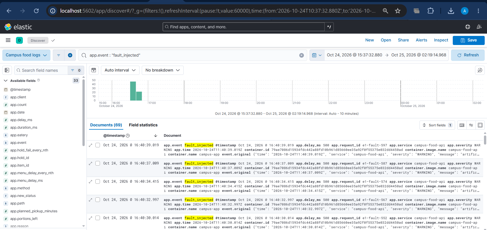

*Figure E1-2 — Kibana Discover, data view "Campus food logs", query `app.event : "fault_injected"`,
2026-10-24 16:30–17:00 local (11:30–12:00 UTC), 30-second bars: **69 documents**, all inside the
fault stage (16:38:39–16:40:39 local). Each one is a WARNING with `app.delay_ms: 500` and a request ID
`e1-fault-N`. The newest, `e1-fault-597` at 16:40:39.019 local (`app.time` 11:40:39.019Z), is the
last second of the stage. 69 matches the prediction (346 menu requests ÷ 5) and the count from the
Elasticsearch API.*

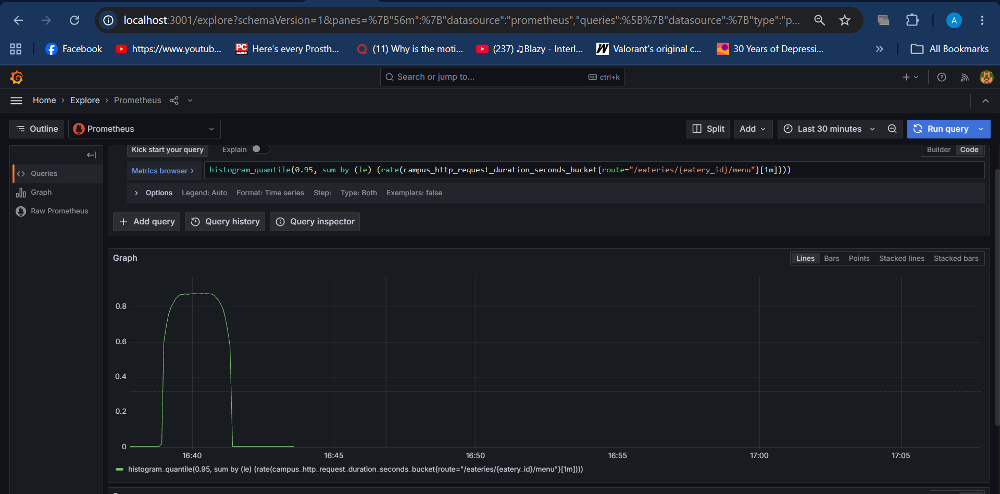

*Figure E1-1a — Grafana Explore, data source Prometheus, query
`histogram_quantile(0.95, sum by (le) (rate(campus_http_request_duration_seconds_bucket{route="/eateries/{eatery_id}/menu"}[1m])))`.
Time axis is local time (UTC+5), 2026-10-24. The menu p95 sits near 0 before the fault, rises to about
0.88 s while the fault is on (16:38:39–16:40:39), and returns to near 0 afterwards. It means: "in the
last minute, 95 % of menu requests took this long or less", estimated from histogram buckets (see the
note under Figure B2). The rise and fall each take about a minute because every point looks back over
a 1-minute window.*

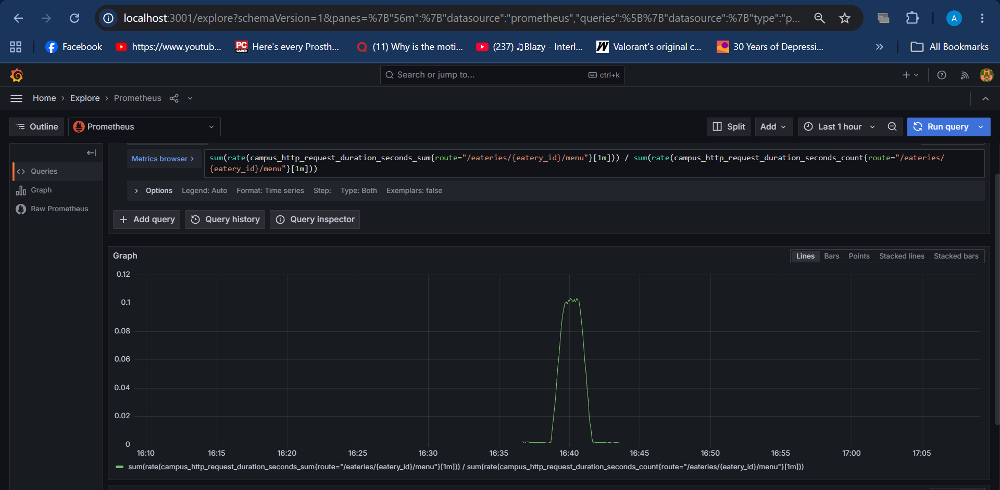

*Figure E1-1b — query
`sum(rate(campus_http_request_duration_seconds_sum{route="/eateries/{eatery_id}/menu"}[1m])) / sum(rate(campus_http_request_duration_seconds_count{route="/eateries/{eatery_id}/menu"}[1m]))`.
Mean menu latency in seconds: close to 0 before and after, and about 0.10 s (the 103 ms measured with
the API) during the fault. The mean rises roughly 74 times but only to 0.1 s, which is why the mean
alone understates a half-second problem for one request in five.*

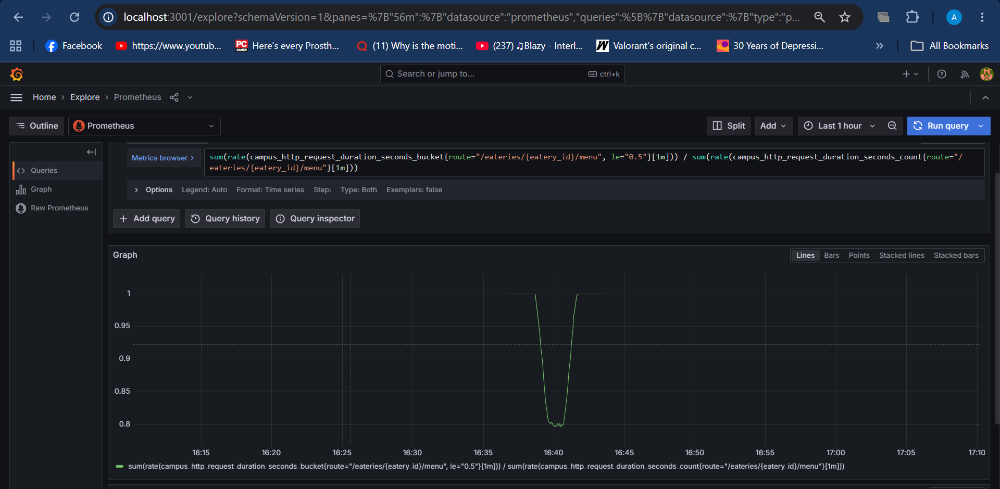

*Figure E1-1c — query
`sum(rate(campus_http_request_duration_seconds_bucket{route="/eateries/{eatery_id}/menu", le="0.5"}[1m])) / sum(rate(campus_http_request_duration_seconds_count{route="/eateries/{eatery_id}/menu"}[1m]))`.
The share of menu requests that finished within 0.5 s: 1.0 normally, dropping to about 0.8 during the
fault because 1 in 5 requests (20 %) now takes just over 0.5 s, and back to 1.0 afterwards.*

These three charts were made in Grafana Explore, so they are not part of the provisioned dashboard
file; the full queries are given above and in the captions so they can be reproduced.

**Cause and effect on users.** Every fifth menu request sleeps before answering, so one in five
students waits an extra half second on the screen they open most. No request fails (status codes are
identical in all stages), which is why the error panel stays quiet. The mean rose about 8×
(14.4 → 113.8 ms) while the p95 rose about 18× (28.5 → 524.8 ms), and a 114 ms mean alone would not
look alarming; that is the argument for charting percentiles and not only averages.

**Recovery.** After `DELETE /admin/faults` the menu mean and p95 return to the baseline level and
`fault_injected` stops appearing in Kibana. In Figures E1-1a to E1-1c the three lines are back at their
baseline values within about a minute of the fault being cleared at 16:40:39 local, which is the length
of the 1-minute window. Client-side, the recovery stage matched the baseline (13.3 ms mean and 28.7 ms
p95, against 14.4 ms and 28.5 ms).

### E2: cardinality explosion

**Method.** `experiments/e2_cardinality.sh` runs `experiments/cardinality/demo.py`, a tiny app exposing
a counter `demo_requests_total` on `:8001/metrics`, capped at 100 unique IDs. It is scraped by the
`cardinality-demo` job in Prometheus, which is DOWN whenever the demo is not running (Figure B1).

1. *With label* (`MODE=request_id`): `demo_requests_total{route="/menu", request_id="<uuid>"}` — a new
   label value, and so a new time series, for every request.
2. *Without label* (`MODE=none`): `demo_requests_total{route="/menu"}` — one series.

Series count: `count(demo_requests_total)` (and `prometheus_tsdb_head_series` for the whole server).

**Expected.** About 100 series with the label; 1 series without it.

**Commands.** `experiments/e2_cardinality.sh` runs both stages and prints the series count for each:
**100** with the `request_id` label and **1** without it (the script originally queried the old
Prometheus port, 9090, and printed 0; it now uses 9091). The manual commands below run the same steps
against the Prometheus HTTP API, and also show what the script does not: that the old series stay
stored after the label is removed. The waits were about 45 s after starting the label run and about
25 s after the restart, which is several 5-second scrapes each.

```bash
docker compose --profile experiments rm -sf cardinality-demo        # clean start
q() { curl -sG localhost:9091/api/v1/query --data-urlencode "query=$1"; echo; }

q 'prometheus_tsdb_head_series'                                     # before
CARDINALITY_MODE=request_id docker compose --profile experiments up -d --build cardinality-demo
sleep 40
q 'count(demo_requests_total)'
q 'prometheus_tsdb_head_series'

docker compose --profile experiments rm -sf cardinality-demo        # stop the labelled version
CARDINALITY_MODE=none docker compose --profile experiments up -d cardinality-demo
sleep 20
q 'count(demo_requests_total)'
q 'count(last_over_time(demo_requests_total[1h]))'
q 'prometheus_tsdb_head_series'
docker compose --profile experiments rm -sf cardinality-demo        # clean up
```

**Results (2026-10-25, about 09:08–09:10 UTC, which is about 14:08 local).**

| Step | Time (UTC) | Query | Result |
|---|---|---|---|
| 0. Before the experiment | 09:08:23 | `prometheus_tsdb_head_series` | **2323** |
| 1. With `request_id` label, 45 s later | 09:09:08 | `count(demo_requests_total)` | **100** |
| | 09:09:09 | `prometheus_tsdb_head_series` | **2439** (+116) |
| 2. Label removed, demo restarted, 25 s later | 09:09:34 | `count(demo_requests_total)` | **1** |
| | 09:09:35 | `count(last_over_time(demo_requests_total[1h]))` | **101** |
| | 09:09:35 | `prometheus_tsdb_head_series` | **2440** |

What the numbers show:

- **One series per request ID.** 100 unique IDs gave `count(demo_requests_total) = 100`. The server's
  total series count rose by 116: 100 for the label values, and (most likely) about 16 for the demo
  target's own standard series such as the Python and process metrics and Prometheus's scrape-health
  series.
- **The fix works for live queries.** After the label was removed and the demo restarted, the count is
  **1**. The old series went stale as soon as the labelled container stopped.
- **But nothing was deleted.** `count(last_over_time(demo_requests_total[1h]))` is **101**: the 100 old
  series are still stored, plus the one new label-free series. The new series is not a merge of the old
  ones; it is a 101st series.
- **Memory is not given back.** `prometheus_tsdb_head_series` is 2440 after the fix, higher than the
  2439 with the label and far above the 2323 before. The old series stay in the in-memory head block
  until Prometheus compacts it to disk, which takes hours, and they only disappear from storage when the
  7-day retention expires.

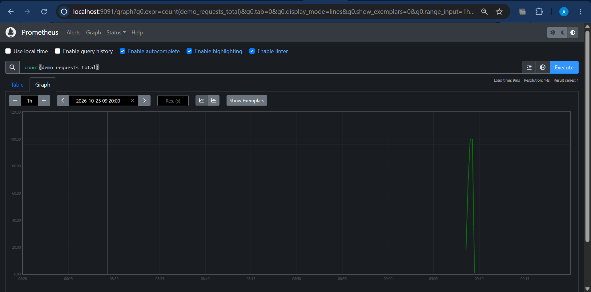

    *Figure E2-1 — Prometheus graph, query `count(demo_requests_total)`, range 1 h ending 2026-10-25 09:20 UTC (x-axis in UTC), resolution 14 s. The count rises to the cap of 100 while the `request_id` label is in use (about 09:08 to 09:09) and drops once the label is removed and the demo restarted (about 09:09:30). The line ends at the bottom because the demo container was removed in the clean-up step, so no series exists after that. This is the same run as the table above.*

**Why it matters at scale.** Every distinct combination of label values is its own time series, and
each series has its own index entry and its own samples. Recent series are held in memory until
Prometheus compacts them to disk (a few hours), and the index grows with the number of series ever
seen in a block. A `request_id` label on a counter that handles 1 million requests a day would
create about 1 million new series a day, each seen once and never queried, at roughly kilobytes of
memory per active series. A histogram multiplies that by its number of buckets (this app's latency
histogram has 10 buckets plus `_sum` and `_count`). Queries and restarts slow down, and the server
can run out of memory long before the 7-day retention removes anything. Metrics answer "how many, how
fast" over many events, so labels must have a small, bounded set of values (route template, status,
eatery). Request IDs answer "what happened to this one request", which is what logs are for:
Elasticsearch stores one document per event and is built to search by exact ID (Figure C2). This
app's `campus_http_requests_total` follows the rule by labelling with the route *template*
(`/eateries/{eatery_id}/menu`) and not the raw path (Figure B2's legend), and unknown paths are
grouped as `unmatched`.

As the assignment notes, removing a label does not delete series already stored. They stop receiving
samples and age out with the 7-day retention.

---

## Credits and assistance

I credit the following sources. The libraries and tools I used are FastAPI, Prometheus, Grafana,
Node Exporter, Filebeat, Elasticsearch and Kibana; the exact version of each is pinned in
`docker-compose.yml`. As for AI assistance, I used Claude (web) for code assistance and for reviewing this report.
