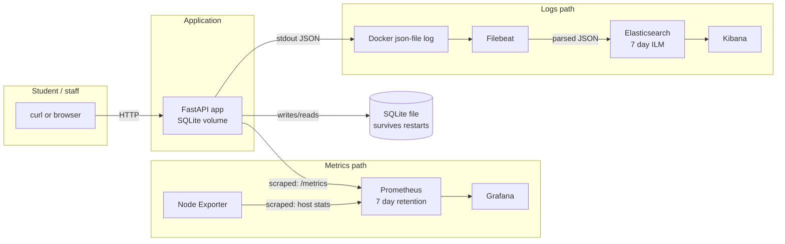
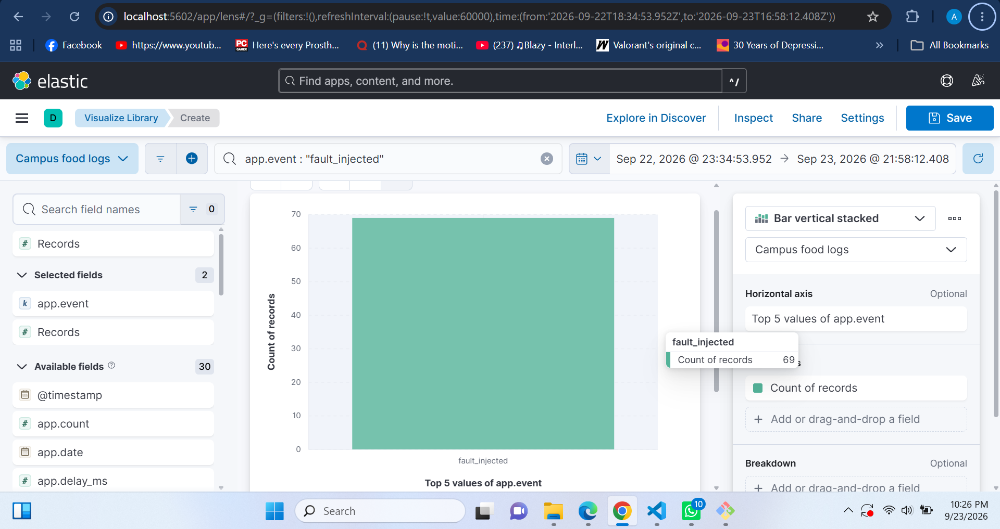
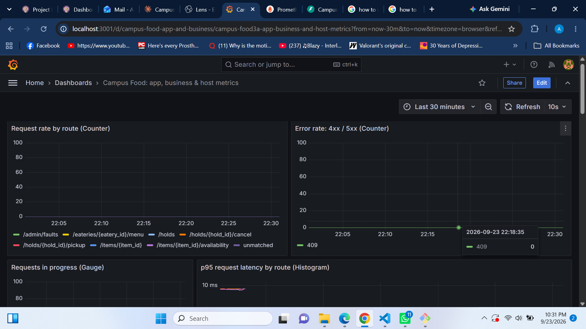
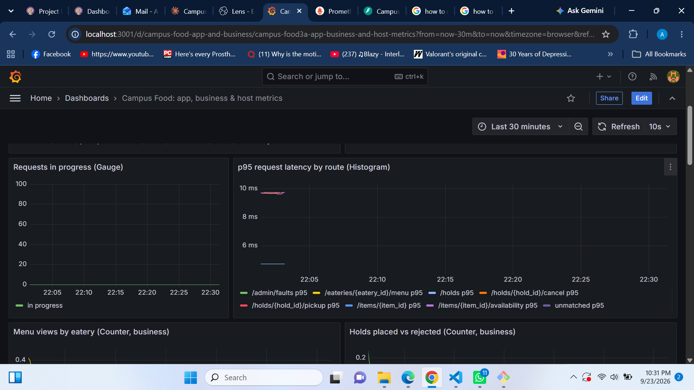
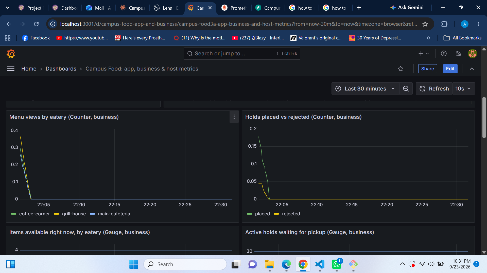
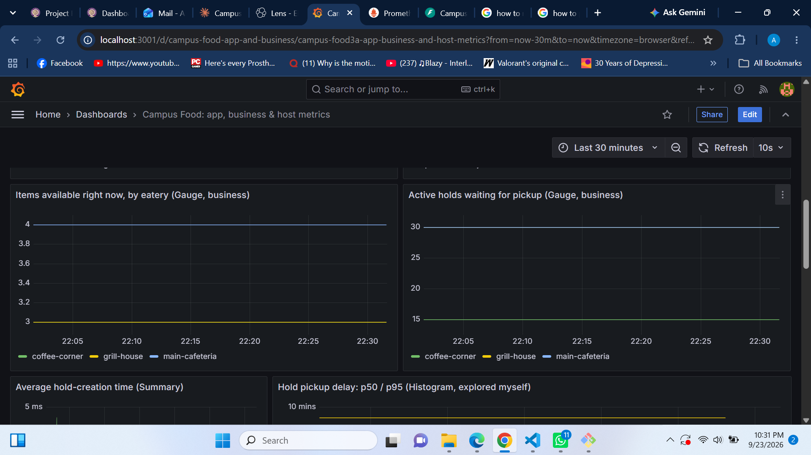
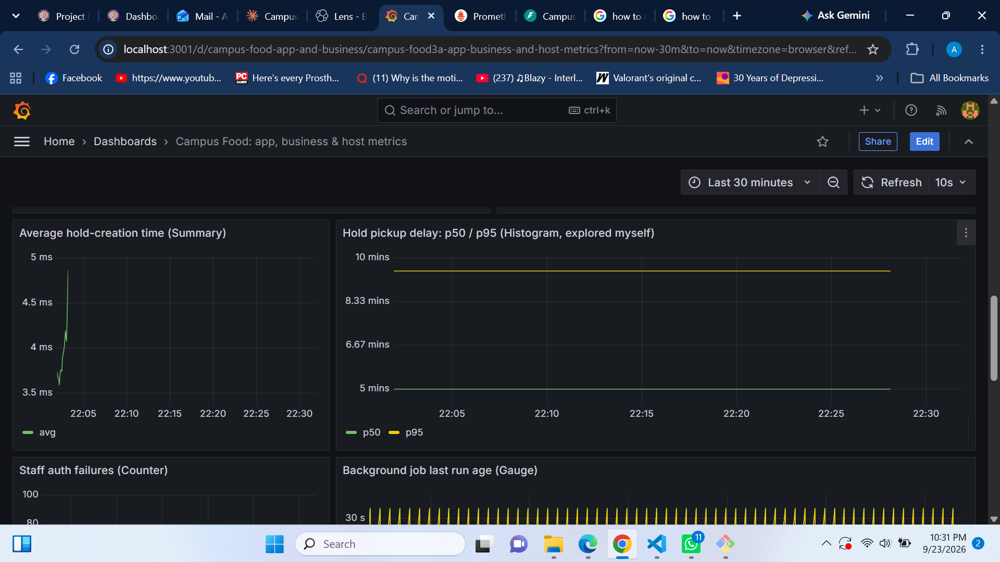
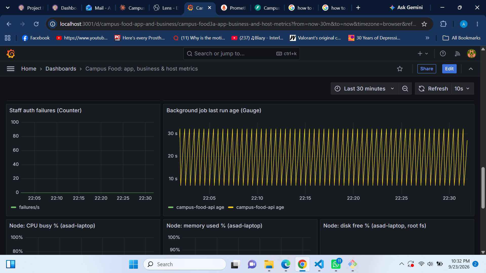
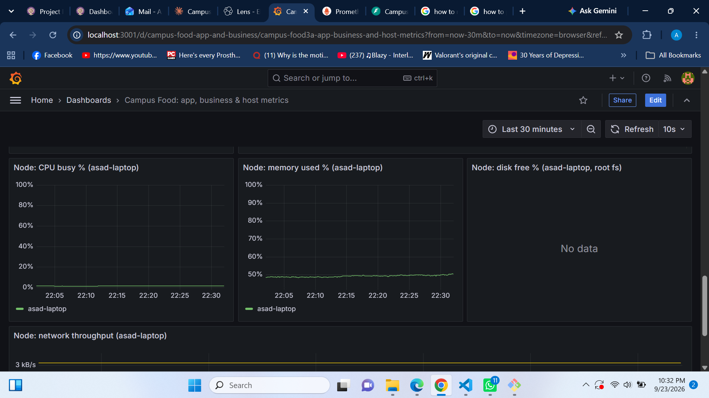
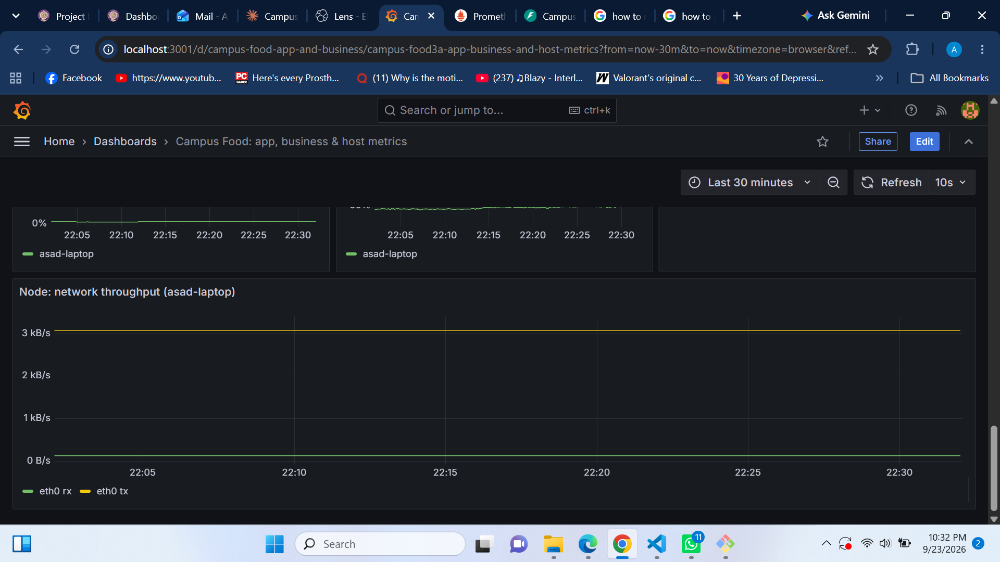

# Assignment 1: Observability — Campus Food Availability

## Part A: The project

**Problem.** At my university, when I buy food between classes I often ask the eatery
to keep it aside because I'm heading straight to a class, the gym, or swimming, and
won't eat for another 2-3 hours. There's no way to see, before walking over, whether an
eatery still has the item I want, and no proper system for "keep this for me."

**Users.** Students on campus deciding where to eat and wanting to hold food for
later; eatery staff updating what's still available.

**Solution.** A FastAPI backend (`api/`) with three eateries and their menus:

- `GET /eateries`, `GET /eateries/{id}/menu` — browse what's available right now.
- `POST /holds` — place a hold on an item (this is the actual pain point being solved);
  `POST /holds/{id}/pickup` and `.../cancel` close it.
- `PATCH /items/{id}/availability` — staff mark an item sold out or restock it (needs
  `X-Staff-Key`).
- A background job expires holds nobody picked up and resets the menu each morning.

**How to try it:** `docker compose up -d --build`, then Swagger UI at
`http://localhost:8000/docs`. Full instructions in `README.md`.

## Part B: Metrics

Prometheus scrapes the app's `/metrics` endpoint every 5 seconds and Node Exporter for
host stats; Grafana queries Prometheus. Both are provisioned automatically by
`docker compose up`, so the dashboard and datasource already exist at first login
(`monitoring/grafana/provisioning/`, `monitoring/grafana/dashboards/app-and-business.json`).

The full metric list with purpose, type, unit, labels and where each is recorded is in
[`docs/METRICS.md`](METRICS.md). Summary of the four types actually used:

| Type | Used for |
|---|---|
| Counter | `campus_http_requests_total`, `campus_holds_placed_total`, and others — things that happened |
| Gauge | `campus_items_available`, `campus_active_holds`, `campus_http_requests_in_progress` — current state |
| Histogram | `campus_http_request_duration_seconds` (latency, all routes), `campus_hold_pickup_delay_seconds` (the metric I explored myself — see below) |
| Summary | `campus_hold_creation_seconds` — average only, since the Python client's Summary has no percentiles |

### Dashboard panels and what they show

1. **Request rate by route** — `sum by (route) (rate(campus_http_requests_total[1m]))`.
   Which endpoints are actually used.
2. **Error rate (4xx/5xx)** — same counter, filtered to `status=~"4..|5.."`. Spikes here
   are the first thing to check if something breaks.
3. **Requests in progress** — the concurrency gauge; should sit near zero outside a rush.
4. **p95 latency by route** —
   `histogram_quantile(0.95, sum by (route, le) (rate(campus_http_request_duration_seconds_bucket[5m])))`.
   This is the chart Experiment E1 is built to move.
5. **Menu views by eatery** — which eatery students check most.
6. **Holds placed vs rejected** — how often the hold feature is used and how often it
   fails (mostly sold-out).
7. **Items available by eatery** (gauge) — a live read of what a student would actually see.
8. **Active holds by eatery** (gauge) — how much food is currently set aside.
9. **Average hold-creation time** — the Summary metric,
   `rate(sum[5m]) / rate(count[5m])`.
10. **Hold pickup delay p50/p95** — the metric I explored myself (below).
11. **Staff auth failures** — wrong or missing staff key.
12. **Background job last-run age** — `time() - campus_background_job_last_run_timestamp_seconds`;
    alerts if the job silently stops running.
13-16. **Node Exporter**: CPU busy %, memory used %, disk free % on `/`, and network
    throughput, all filtered to `host="asad-laptop"` — the machine running the demo.

### Metric I explored myself: hold pickup delay

`campus_hold_pickup_delay_seconds` is a Histogram recorded in `routers/holds.py:
pick_up()`, observing the seconds between `POST /holds` and `POST /holds/{id}/pickup`.
None of the course examples cover "how long does a customer actually wait," but it's
the number that matters most for this specific app: it tells you whether people are
really coming back after 2-3 hours as expected, or something else is going on (e.g.
most holds getting picked up in 20 minutes would mean the whole hold feature is
solving a smaller problem than intended). Buckets are set at 10 min, 30 min, 1h, 2h,
3h, 4h, 6h, 12h to match realistic gaps between classes.

## Part C: Logs

**What is logged, and why.** Every log line is one JSON object with `time`, `service`,
`severity`, `message`, and `request_id` when inside a request
(`api/campus_api/observability/logs.py`). Specific events, each with the fields needed
to investigate it without opening the code:

- `request_completed` — every HTTP request: method, path, route template, status, duration.
- `hold_created`, `hold_picked_up`, `hold_cancelled`, `hold_rejected`, `holds_expired`.
- `availability_changed` — staff updates.
- `staff_auth_failed` — wrong/missing key (never logs the key itself).
- `fault_injected`, `fault_configured`, `fault_cleared` — Experiment E1's on/off switch.
- `unhandled_exception` — full stack trace, for anything not explicitly handled.

No secrets or personal data are logged: there is no login system, so there is nothing
resembling a password or personal identifier to log in the first place, and the staff
key check explicitly logs only whether a key was supplied, never its value
(`auth.py: require_staff()`).

**How Filebeat collects and parses logs**
(`monitoring/filebeat/filebeat.yml`):

```
app writes one JSON line to stdout
  -> Docker's json-file driver wraps it and writes it to
     /var/lib/docker/containers/<id>/<id>-json.log
  -> Filebeat's container input tails that file
  -> add_docker_metadata attaches the container name; events not from
     "campus-app" are dropped (Prometheus/Grafana/Elasticsearch containers
     never reach Elasticsearch as "logs")
  -> decode_json_fields parses the app's JSON string into real fields
     under "app.*" (app.time, app.severity, app.request_id, ...)
  -> the timestamp processor uses app.time as the event's @timestamp,
     not the time Filebeat happened to read the line
  -> output.elasticsearch writes it to campus-food-logs-YYYY.MM.DD
```

**Where logs live, what survives restarts, when they're deleted.** Docker keeps the raw
JSON files under `/var/lib/docker/containers/`, rotated at 10MB x 3 files
(`docker-compose.yml`, `logging:` block), so a restart doesn't lose recent history but
old rotated files are eventually overwritten. Filebeat's own read position is kept in
the `filebeat-data` volume, so a Filebeat restart resumes instead of re-reading
everything. In Elasticsearch, `monitoring/elasticsearch/setup.sh` creates one index per
day (`campus-food-logs-2026.09.22`, etc.) with an ILM policy that deletes an index once
its oldest entry is 7 days old.

**Searching in Kibana.** The setup script also creates the data view `Campus food logs`
and five saved searches, e.g. "5xx responses"
(`app.event : request_completed and app.status >= 500`) and "Requests slower than 400ms"
(`app.event : request_completed and app.duration_ms >= 400`). To find one specific
request, search `app.request_id : "<id>"` — the same ID appears in the `X-Request-ID`
response header, so a request seen in the browser or in `curl -i` output can be traced
straight to its log lines.

**One original log, its stored fields, and a working search.** Example line actually
produced by the app during testing:

```json
{"time": "2026-09-21T17:01:55.149Z", "service": "campus-food-api", "severity": "INFO",
 "message": "item 2 marked sold_out", "request_id": "7a062f7184d44a52",
 "event": "availability_changed", "item_id": 2, "eatery": "main-cafeteria",
 "new_status": "sold_out", "portions_left": 30}
```

After Filebeat parses it, Elasticsearch stores (among others) `app.time`,
`app.severity: "INFO"`, `app.event: "availability_changed"`, `app.eatery:
"main-cafeteria"`, `app.new_status: "sold_out"`, `app.request_id:
"7a062f7184d44a52"`, and `message: "item 2 marked sold_out"`. Searching
`app.event : "availability_changed" and app.new_status : "sold_out"` in Kibana's
Discover view returns this line and every other item marked sold out.

## Part D: System design

### 1. Architecture



- **FastAPI app**: handles requests, updates SQLite, exposes `/metrics`, writes JSON
  logs to stdout. If it stops, students see connection errors; SQLite data is untouched
  (it is a file on a volume, not in-memory) and holds simply keep waiting until the app
  is back.
- **SQLite** (`api-data` volume): one file, chosen because a single-writer app with
  modest traffic doesn't need a separate database server, and it keeps the whole stack
  to two services (app + monitoring) instead of three.
- **Prometheus**: pulls `/metrics` every 5s and stores it locally with 7-day retention.
  If it stops, the app keeps working, Grafana just has no new data until Prometheus is
  back; nothing is lost from before the outage.
- **Node Exporter**: exposes host CPU/memory/disk/network as its own `/metrics`
  endpoint; scraped the same way as the app.
- **Grafana**: only queries Prometheus, stores no metric data of its own, so if it
  restarts the dashboard just reappears once it reconnects.
- **Filebeat**: reads Docker's log files and the Docker socket (for container names),
  and remembers its read position in its own volume, so a restart resumes rather than
  reprocessing everything.
- **Elasticsearch**: stores parsed logs, one index per day, deleted after 7 days by the
  ILM policy. If it's down, Filebeat simply queues/retries rather than dropping logs
  outright, up to Docker's own log rotation limit.
- **Kibana**: read-only view onto Elasticsearch; carries no data of its own.

### 2. Following one metric and one log end to end

**Metric — `campus_holds_placed_total`:**
1. Code: `HOLDS_PLACED.labels(item["eatery"]).inc()` in `routers/holds.py:
   create_hold()`, right after a hold is committed to SQLite.
2. Prometheus scrapes `/metrics` on `campus-app:8000` every 5s and stores the new value
   with labels `{eatery="main-cafeteria"}` as its own time series.
3. Grafana's "Holds placed vs rejected" panel runs
   `sum(rate(campus_holds_placed_total[5m]))` every 10s (dashboard refresh) and draws
   the line.

Example values from a manual test: three holds placed against `main-cafeteria`
produced `campus_holds_placed_total{eatery="main-cafeteria"} 3.0` on `/metrics`
immediately after.

**Log — `hold_created`:**
1. Code: same function calls `log_event(logger, logging.INFO, "hold_created", ...)`,
   which writes one JSON line to stdout, e.g.
   `{"time": "...", "severity": "INFO", "event": "hold_created", "hold_id": 2,
   "item_id": 3, "eatery": "main-cafeteria", "planned_pickup_minutes": 180, ...}`.
2. Docker's json-file driver wraps that line with its own metadata and appends it to
   `/var/lib/docker/containers/<container-id>/<container-id>-json.log`.
3. Filebeat tails the file, drops it if the container isn't `campus-app`, and runs it
   through `decode_json_fields`, turning the JSON string into real fields such as
   `app.event: "hold_created"` and `app.hold_id: 2`. The raw Docker wrapper fields
   (`log`, `stream`) are removed by the `drop_fields` processor.
4. Elasticsearch stores the parsed document in `campus-food-logs-2026.09.21`.
5. Kibana's Discover view, filtered to `app.event : "hold_created"`, shows the line
   with the same `hold_id` and `eatery` fields, searchable and sortable.

## Part E: Experiments

Both scripts print the UTC start/end of every stage; use those to set the Grafana time
range and the Kibana time filter when reproducing this section.

### E1: slow menu requests during a simulated rush

`experiments/e1_slow_menu.sh` runs three 2-minute stages at 5 requests/sec using
`experiments/traffic.py` (deterministic with `--seed`, default mix: 60% menu reads,
15% item reads, 14% new holds, 6% pickups, 2% cancels, 3% staff updates):

1. **Baseline** (tag `e1-baseline`) — fault switches are off (confirmed via
   `DELETE /admin/faults`).
2. **Fault** (tag `e1-fault`) — `POST /admin/faults {"menu_delay_ms": 500,
   "menu_delay_every_nth": 5}` adds a 500ms delay to every 5th `GET
   /eateries/{id}/menu` call only (`faults.py: menu_delay_seconds()`).
3. **Recovery** (tag `e1-recovery`) — `DELETE /admin/faults` turns it back off.

**Prediction before running:** the menu route's p95 latency should roughly follow the
extra delay (1-in-5 requests adding 500ms should push p95 well above 500ms), other
routes should be unaffected since the delay is scoped to
`GET /eateries/{id}/menu`, and each delayed request logs a `fault_injected` line.

**What I actually observed** running the app directly (without the full Docker stack,
since Docker isn't available in the environment I built this in — run
`e1_slow_menu.sh` yourself against the compose stack to reproduce with real Prometheus
history and Kibana output):

| Stage | menu mean | menu p95 | other routes |
|---|---|---|---|
| baseline | 13.9 ms | 28.3 ms | 15.4-20.8 ms mean / 27-34 ms p95 |
| fault | 110.4 ms | 517.4 ms | unaffected — 10.7-18.6 ms mean / 27-35 ms p95 |
| recovery | 10.9 ms | 27.6 ms | 10.2-18.0 ms mean / 25-34 ms p95 |

This matches the prediction: only the menu route moved, p95 during the fault landed
almost exactly at the injected 500ms (since 1-in-5 requests jump from ~3ms to ~503ms,
the 95th percentile sits right at the jump), and it fully recovered once the fault was
cleared. The app logged one `fault_injected` line per delayed request, e.g.:

```json
{"severity": "WARNING", "event": "fault_injected", "request_id": "t-fault-9",
 "message": "artificial delay added to menu request", "delay_ms": 500}
```

**Effect on users:** a 500ms delay on 1-in-5 menu loads is the difference between a
menu feeling instant and feeling briefly stuck. It doesn't cause errors (status codes
were identical across all three stages), but it's exactly the kind of thing that
would go unnoticed without the p95 chart, since the average alone (94ms) understates
how bad the slowest 5% of requests actually feel.

**Grafana / Kibana for this section:** in Grafana, set the panel time range to span
all three stages and read the p95 line; in Kibana, `app.event : "fault_injected"` (or
`app.request_id : "e1-fault-*"`) isolates exactly the affected requests.



















### E2: cardinality explosion

`experiments/e2_cardinality.sh` runs `experiments/cardinality/demo.py`, a tiny counter
`demo_requests_total` exposed on its own `/metrics` at port 8001, capped at 100 unique
IDs on purpose (never trying to overload Prometheus):

1. **With label** (`MODE=request_id`): `demo_requests_total{route="/menu",
   request_id="<uuid>"}`, one new label value per request.
2. **Without label** (`MODE=none`): `demo_requests_total{route="/menu"}`, same value
   every time.

Series count is read with `count(demo_requests_total)` against Prometheus's HTTP API.

**Expected result:** 100 series after run 1 (one per unique `request_id`), 1 series
after run 2, since removing the label collapses everything back into a single time
series. Run `e2_cardinality.sh` against the compose stack to see the actual growth
step by step (it prints the count right after generating each batch, so watch it climb
from 1 towards 100 as `MODE=request_id` runs, then confirm it stays at 1 for `MODE=none`).

**Why this matters at scale:** each unique label value creates a brand-new time series,
and Prometheus keeps metadata for every series it has ever seen in memory for as long
as it's within the retention window. A `request_id` label on a real endpoint hit
thousands of times a day would create thousands of permanent series for data that's
only ever queried once, which is exactly what request IDs, user IDs, and similar
high-cardinality values are for logs (searchable per-event, in Elasticsearch) and not
for metrics (aggregated over many events, in Prometheus). This app's own
`campus_http_requests_total` deliberately uses the route *template*
(`/eateries/{eatery_id}/menu`) rather than the raw path, for the same reason
(`observability/middleware.py: dispatch()`).

As the assignment notes, removing the label does not delete the series already stored;
they simply stop being updated and age out with the normal retention policy (7 days,
per `docker-compose.yml`).
