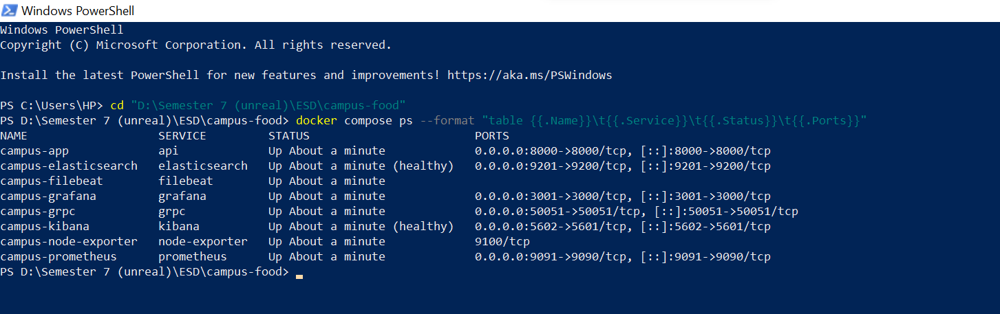
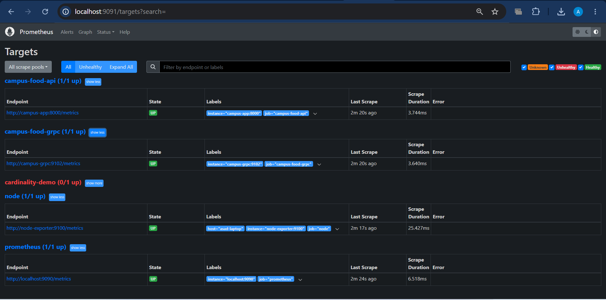
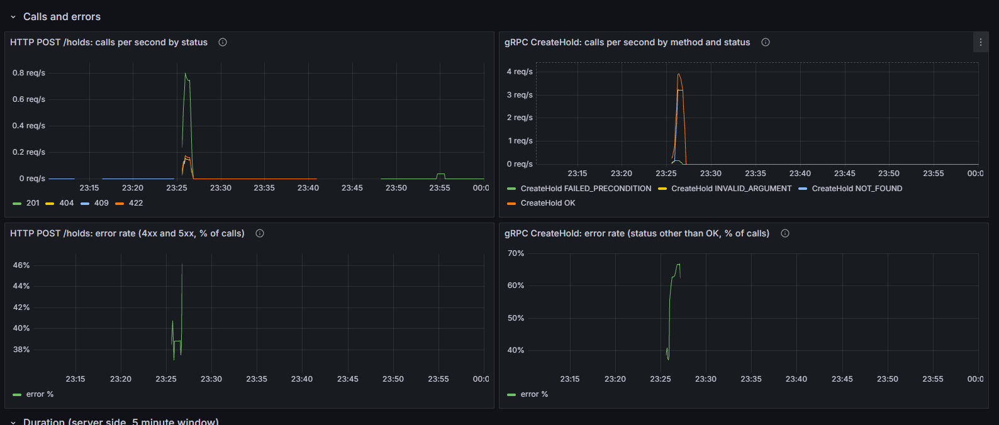
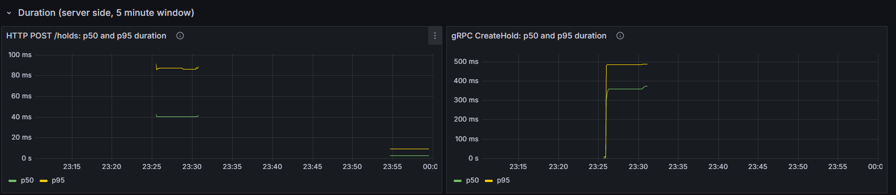
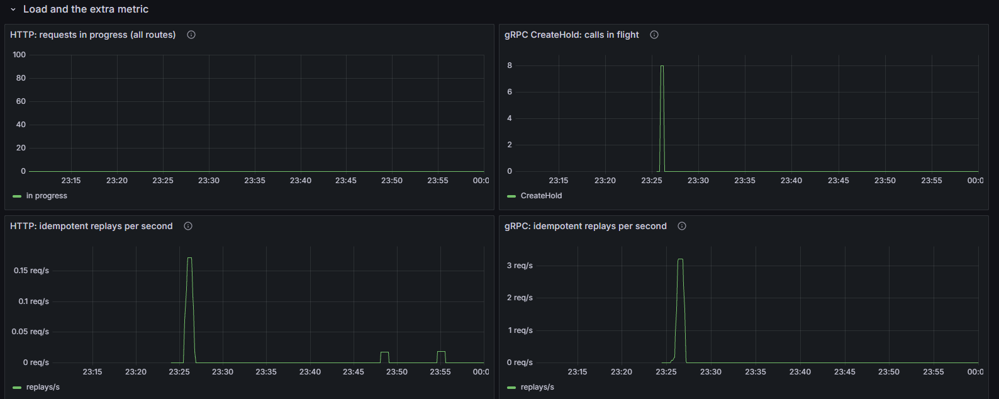

# Assignment 2: Evidence (Parts A, B and C)

Section A is the HTTP API, section B the gRPC service, section C the metrics. Screenshots are in `docs/img/`.

# A. HTTP API

All outputs below were captured from the running stack (`docker compose up -d --build api`, API at `http://localhost:8000`).

---

## A1. Automated tests

Command (from `api/`):

```powershell
$env:DB_PATH="$env:TEMP\campus_test.db"
python -m pytest -v
```

Result: 17 passed when this screenshot was taken (the suite now has 33 tests, because the gRPC and metrics tests were added in Parts B and C). The only message was a Starlette deprecation warning about `httpx` in the test client, which does not affect results.


Tests cover:

| Requirement | Test |
|---|---|
| Valid request | `test_create_hold_valid` |
| Invalid input | `test_create_hold_invalid_input` |
| Repeated request | `test_repeated_request_same_key_creates_one_hold` |
| Reused key, different body | `test_same_key_different_body_is_rejected` |
| Error envelope | `test_error_envelope_shape`, `test_unknown_route_uses_same_envelope` |
| Rate limit | `test_rate_limit_returns_429_with_retry_after`, `test_rate_limit_only_affects_hold_creation` |

---

## A2. Consistent error format

Every error uses `{"error": {"code", "message", "request_id", "details"?}}`. The `request_id` in the body equals the `x-request-id` response header, which is the same ID written to the JSON logs.

**404, unknown hold**

```
$ curl.exe -i localhost:8000/holds/9999
HTTP/1.1 404 Not Found
content-type: application/json
x-request-id: 72542927ffbd49aa

{"error":{"code":"HOLD_NOT_FOUND","message":"hold not found","request_id":"72542927ffbd49aa"}}
```

**422, invalid input** (`item_id` must be greater than 0)

```
$ curl.exe -i -X POST localhost:8000/holds -H "Content-Type: application/json" -d '{"item_id": 0}'
HTTP/1.1 422 Unprocessable Entity
content-type: application/json
x-request-id: 04795cd4ae924385

{"error":{"code":"VALIDATION_ERROR","message":"request validation failed","request_id":"04795cd4ae924385","details":[{"field":"item_id","message":"Input should be greater than 0"}]}}
```

**404, unknown route** (same envelope, not FastAPI's default body)

```
$ curl.exe -i localhost:8000/nope
HTTP/1.1 404 Not Found
content-type: application/json
x-request-id: 919f426ba1154157

{"error":{"code":"NOT_FOUND","message":"Not Found","request_id":"919f426ba1154157"}}
```

**Link between response and logs**

The 404 response above carried `request_id` `72542927ffbd49aa` (also in the `x-request-id` header). Searching Kibana (data view `Campus food logs`, time range covering 20 Oct 2026) for `app.request_id: "72542927ffbd49aa"` returns exactly one log entry from the API container:

| Field | Value |
|---|---|
| `@timestamp` | `2026-10-20T19:01:02.397Z` |
| `app.request_id` | `72542927ffbd49aa` |
| `app.event` | `request_completed` |
| `app.method` / `app.path` | `GET` / `/holds/9999` |
| `app.route` | `/holds/{hold_id}` |
| `app.status` | `404` |
| `app.severity` | `WARNING` |
| `app.duration_ms` | `2.8` |
| `container.name` | `campus-app` |
| `_index` | `campus-food-logs-2026.10.20` |

The raw log line (`event.original`) that the API wrote to stdout and Filebeat shipped:

```json
{"time": "2026-10-20T19:01:02.397Z", "service": "campus-food-api", "severity": "WARNING", "message": "GET /holds/{hold_id} -> 404", "request_id": "72542927ffbd49aa", "event": "request_completed", "method": "GET", "path": "/holds/9999", "route": "/holds/{hold_id}", "status": 404, "duration_ms": 2.8}
```

So the ID the client receives in the error body is the same ID that appears in the logs, which lets an error report be traced to its log line. The log records the route template (`/holds/{hold_id}`) as well as the real path, which keeps the metric/log label bounded.


---

## A3. Idempotency (`Idempotency-Key` on `POST /holds`)

The same request was sent twice with `Idempotency-Key: demo-1`.

**First call: creates the hold**

```
HTTP/1.1 201 Created
x-request-id: 91fcb66d2c304895

{"id":248,"item_id":1,"eatery":"main-cafeteria","pickup_code":"0593","status":"active","planned_pickup_minutes":180}
```

**Second call: replays the stored response**

```
HTTP/1.1 201 Created
idempotent-replayed: true
x-request-id: 6055c4a7550646e7

{"id":248,"item_id":1,"eatery":"main-cafeteria","pickup_code":"0593","status":"active","planned_pickup_minutes":180}
```

Same hold id (248) and pickup code, plus the `idempotent-replayed: true` header, so no second hold was created.

How it works: the key and a hash of the request body are stored in the `idempotency_keys` table in the same transaction as the hold. The same key with a different body returns `422 IDEMPOTENCY_KEY_REUSED`. `BEGIN IMMEDIATE` makes two simultaneous retries queue up instead of both creating a hold.

Other operations:

- `PATCH /items/{id}/availability` sets an absolute value, so repeating it gives the same result.
- `GET` endpoints are safe to repeat.
- `pickup` and `cancel` return `409 HOLD_NOT_ACTIVE` on a repeat and change nothing.

---

## A4. Rate limiting (`POST /holds`)

**Limit:** 5 requests per 10 seconds, sliding window, in memory (single instance).
**Shared by:** all callers with the same client IP (inside Docker, host requests often share the gateway IP). `X-Forwarded-For` is not trusted because a client can fake it.
**Allowed again:** when the oldest counted request leaves the 10 s window, which is the number of seconds in `Retry-After`. Rejected requests are not counted, so retrying does not extend the block.

**Accepted requests, then 429**

```
request 1 -> 201
request 2 -> 201
request 3 -> 201
request 4 -> 201
request 5 -> 201
request 6 -> 429
request 7 -> 429
```

**The 429 response**

```
HTTP/1.1 429 Too Many Requests
retry-after: 10
content-type: application/json
x-request-id: 433156db6b5e48dc

{"error":{"code":"RATE_LIMITED","message":"too many requests, retry in 10s","request_id":"433156db6b5e48dc"}}
```

**Allowed again after waiting 10 seconds**

```
HTTP/1.1 201 Created
x-request-id: 878f9e0bf58249e7

{"id":254,"item_id":4,"eatery":"main-cafeteria","pickup_code":"8854","status":"active","planned_pickup_minutes":180}
```

The limiter logs each rejection (`event: rate_limited`), alongside the normal request log:

```json
{"time": "2026-10-20T19:02:53.346Z", "service": "campus-food-api", "severity": "WARNING", "message": "rate limit hit, retry in 10s", "request_id": "433156db6b5e48dc", "event": "rate_limited", "client": "172.19.0.1", "retry_after": 10}
```

---

## A5. Python caller (`caller/client.py`)

**Settings**

| Setting | Value |
|---|---|
| Connect timeout | 1 s |
| Read timeout | 2 s |
| Retry limit | 3 attempts per call (2 retries) |
| Backoff | 0.5 s, then 1 s, plus up to 0.1 s random jitter |
| Retried on | timeouts, connection errors, 502/503/504 |
| Never retried | 4xx responses; `POST` without an `Idempotency-Key` |
| Breaker opens after | 3 consecutive failed attempts |
| Breaker recovery period | 10 s, then one half-open trial call |

`POST /holds` is retried only because the caller sends one `Idempotency-Key` per logical operation and reuses it on every retry.

**Failure used:** the A1 fault switch `menu_delay_ms=3000` (longer than the 2 s read timeout), set and cleared through `/admin/faults`. Rate limiting is demonstrated separately in section 4.

**Output** (run on 2026-10-21)

```
00:03:56 === Phase 1: healthy server
00:03:56 --- menu read 1
00:03:56 GET /eateries/1/menu -> 200 (attempt 1)
00:03:56     result: 200, 4 items
00:03:56 --- menu read 2
00:03:56 GET /eateries/1/menu -> 200 (attempt 1)
00:03:56     result: 200, 4 items
00:03:56 --- menu read 3
00:03:56 GET /eateries/1/menu -> 200 (attempt 1)
00:03:56     result: 200, 4 items
00:03:56 POST /holds -> 201 (attempt 1)
00:03:56     hold created: id=255 (Idempotency-Key 06f800cd...)
00:03:56 === Phase 2: inject 3000 ms delay (read timeout is 2.0s)
00:03:56 [demo] menu delay set to 3000 ms
00:03:56 --- menu read (expect timeouts and retries)
00:03:58 GET /eateries/1/menu attempt 1/3 failed: ReadTimeout
00:03:58   retrying in 0.52s
00:04:01 GET /eateries/1/menu attempt 2/3 failed: ReadTimeout
00:04:01   retrying in 1.08s
00:04:04 [breaker] closed -> open
00:04:04 GET /eateries/1/menu attempt 3/3 failed: ReadTimeout
00:04:04     result: FAILED (GET /eateries/1/menu failed)
00:04:04 --- menu read (expect: blocked by open breaker)
00:04:04 GET /eateries/1/menu BLOCKED: breaker is open, no request sent
00:04:04     result: FAILED (/eateries/1/menu)
00:04:04 --- menu read (expect: still blocked)
00:04:04 GET /eateries/1/menu BLOCKED: breaker is open, no request sent
00:04:04     result: FAILED (/eateries/1/menu)
00:04:04 === Phase 3: remove fault, wait out the recovery period
00:04:04 [demo] menu delay set to 0 ms
00:04:15 --- trial call (half-open)
00:04:15 [breaker] open -> half_open
00:04:15 [breaker] half_open -> closed
00:04:15 GET /eateries/1/menu -> 200 (attempt 1)
00:04:15     result: 200, 4 items
00:04:15 --- menu read (breaker closed again)
00:04:15 GET /eateries/1/menu -> 200 (attempt 1)
00:04:15     result: 200, 4 items
```

**What the output shows**

| Behaviour | Where |
|---|---|
| Success | Phase 1, all calls `200`/`201` |
| Timeout and retry with backoff | Phase 2, attempts 1 and 2 fail with `ReadTimeout`, retries after 0.52 s and 1.08 s |
| Breaker opens | `[breaker] closed -> open` on the third failed attempt |
| Calls blocked while open | Two `BLOCKED` lines with no request sent to the server |
| Recovery | After the 10 s wait: `open -> half_open`, trial call succeeds, `half_open -> closed`, next call succeeds |

Note: the breaker counts failed *attempts*, not whole calls, so it opened during the first failing call. The breaker's state-change line prints just before the caller's result line, which is why `closed -> open` appears above `attempt 3/3 failed`.

---

## A6. OpenAPI

**Export and validation**

```
$ curl.exe -s localhost:8000/openapi.json -o openapi.json
$ Select-String -Path openapi.json -Pattern "HTTPValidationError" -Quiet
False
$ python -m openapi_spec_validator openapi.json
openapi.json: OK
```

`False` means the spec no longer contains FastAPI's default validation-error schema, so every 422 is documented with the project's own `ErrorResponse`.

**Using the spec to test an endpoint**

In Swagger UI (`http://localhost:8000/docs`, generated from the spec), I used "Try it out" on `POST /holds` with a body that breaks the documented constraint `item_id > 0`:

Request body:

```json
{"item_id": 0}
```

Response `422`:

```json
{
  "error": {
    "code": "VALIDATION_ERROR",
    "message": "request validation failed",
    "request_id": "6d311847750945c5",
    "details": [
      {
        "field": "item_id",
        "message": "Input should be greater than 0"
      }
    ]
  }
}
```

The response matches the `ErrorResponse` schema that the spec lists for the 422 response of `POST /holds` (`error.code`, `error.message`, `error.request_id`, `error.details`), so the documentation and the running API agree.


---

## A7. A1 regression check

After the Part A changes (error envelope, validation, idempotency, rate limit), I re-ran the Assignment 1 traffic generator and checked Prometheus, Grafana and Kibana.


```
$ python -m traffic
tag=run requests=595 duration=120s
status codes: {201: 42, 200: 508, 409: 8, 429: 37}
  menu    n= 346 mean=    9.6 ms  p95=   26.5 ms
  item    n=  96 mean=    8.4 ms  p95=   21.1 ms
  hold    n=  87 mean=   12.2 ms  p95=   26.5 ms
  pickup  n=  25 mean=   17.2 ms  p95=   31.5 ms
  cancel  n=  15 mean=   14.8 ms  p95=   36.5 ms
  staff   n=  26 mean=   13.9 ms  p95=   25.4 ms
```

The rate limit was at its default (5 per 10 s) during this run. All 37 `429` responses came from hold creation (42 + 8 + 37 = 87 = the `hold` count); every menu, item, pickup, cancel and staff call succeeded. The 8 `409` responses are items that ran out of portions. This confirms the A1 traffic generator still works and that the limiter only affects `POST /holds`.

| Tool | Result | Evidence |
|---|---|---|
| Prometheus (`localhost:9091/targets`) | `api` target UP. `cardinality-demo` is DOWN, which is expected: that container belongs to Experiment E2 and only starts with the `experiments` profile. | `docs/img/prometheus.png` |
| Grafana (`localhost:3001`) | Dashboard panels show the request, hold and status-code activity from the run above. | `docs/img/grafana_01.png` |
| Kibana (`localhost:5602`, data view `Campus food logs`) | Fresh log entries are indexed and each carries the `request_id`. | `docs/img/kibana_request_72542927ffbd49aa.png` |

---

# B. gRPC service

All outputs in this section were captured from the running stack (`docker compose up -d --build`):
HTTP API `campus-app` on `localhost:8000`, gRPC service `campus-grpc` on `localhost:50051`, both
using the same SQLite file on the `api-data` volume. The client for both versions is
`caller/grpc_client.py` (`--via http` switches it to the HTTP version of the same operation). The call
paths are drawn in `docs/img/call_paths.png` (see `docs/A2_REPORT.md`, Part B).


## B1. Both services running

```powershell
docker compose ps --format "table {{.Name}}\t{{.Service}}\t{{.Status}}\t{{.Ports}}"
```

`campus-app` and `campus-grpc` are both up, next to Prometheus, Grafana, Node Exporter, Filebeat, Elasticsearch and Kibana.



---

## B2. Success through both versions

```
$ python caller/grpc_client.py --item-id 1
via:      grpc   request_id: 63e9b476005d46e8
status:   OK
hold:     id=457 item_id=1 eatery=main-cafeteria pickup_code=8967 status=active planned_pickup_minutes=180
replayed: False
duration: 68.0 ms

$ python caller/grpc_client.py --item-id 1 --via http
via:      http   request_id: 725d571585e642c5
status:   201 Created
hold:     id=458 item_id=1 eatery=main-cafeteria pickup_code=1746 status=active planned_pickup_minutes=180
replayed: False
duration: 19.9 ms
```

Same operation, same result shape. The two holds have consecutive ids (457 from gRPC, 458 from
HTTP) because both services write to the same `holds` table in the same database file, so there is
one source of truth and one id sequence.

---

## B3. Failure 1: item does not exist

```
$ python caller/grpc_client.py --item-id 9999
via:      grpc   request_id: 4c57a170826e4b3c
status:   NOT_FOUND (error code ITEM_NOT_FOUND)
message:  item not found
duration: 58.8 ms

$ python caller/grpc_client.py --item-id 9999 --via http
via:      http   request_id: 79488be6c71647ea
status:   404 Not Found (error code ITEM_NOT_FOUND)
message:  item not found
duration: 15.3 ms
```

---

## B4. Failure 2: item sold out

Item 2 was switched off with the staff endpoint (`PATCH /items/2/availability`, `available: false`),
then restored afterwards.

```
$ python caller/grpc_client.py --item-id 2
via:      grpc   request_id: ab83f7000d364783
status:   FAILED_PRECONDITION (error code ITEM_SOLD_OUT)
message:  item is sold out
duration: 58.7 ms

$ python caller/grpc_client.py --item-id 2 --via http
via:      http   request_id: 85420cb7ddeb4af9
status:   409 Conflict (error code ITEM_SOLD_OUT)
message:  item is sold out
duration: 12.1 ms
```

---

## B5. What the statuses mean

The business rule fails with one stable code (`ITEM_NOT_FOUND`, `ITEM_SOLD_OUT`,
`VALIDATION_ERROR`). Each version turns the code into its own status.

| Case | Code | HTTP | gRPC | Meaning |
|---|---|---|---|---|
| Hold created | none | 201 Created | OK | The request worked and a new hold exists |
| Item 9999 does not exist | `ITEM_NOT_FOUND` | 404 Not Found | NOT_FOUND | The thing asked for is not there |
| Item 2 switched off | `ITEM_SOLD_OUT` | 409 Conflict | FAILED_PRECONDITION | The request is fine, but the item is not in the state the operation needs |
| `item_id` 0 | `VALIDATION_ERROR` | 422 Unprocessable Entity | INVALID_ARGUMENT | The request itself is wrong |

HTTP statuses come with a text body in the common error envelope. gRPC has a fixed list of
status codes, so the app's own code travels as `x-error-code` trailing metadata, which the client
prints as "error code".

Note on the durations: each run of the command-line client is a new process with a new channel, so
the gRPC times include connection setup and are not a fair comparison with HTTP. Server-side
duration is measured in Part C.

---

## B6. Request ID across the gRPC boundary

The client chose the request IDs below and sent them as `x-request-id` metadata.

```
$ python caller/grpc_client.py --item-id 1 --request-id a2-grpc-ok
via:      grpc   request_id: a2-grpc-ok
status:   OK
hold:     id=459 item_id=1 eatery=main-cafeteria pickup_code=9669 status=active planned_pickup_minutes=180
replayed: False
duration: 25.4 ms

$ python caller/grpc_client.py --item-id 9999 --request-id a2-grpc-notfound
via:      grpc   request_id: a2-grpc-notfound
status:   NOT_FOUND (error code ITEM_NOT_FOUND)
message:  item not found
duration: 57.4 ms

$ python caller/grpc_client.py --item-id 0 --request-id a2-grpc-invalid
via:      grpc   request_id: a2-grpc-invalid
status:   INVALID_ARGUMENT (error code VALIDATION_ERROR)
message:  item_id: Input should be greater than 0
duration: 59.2 ms
```

Filebeat was restarted before these calls so that it keeps logs from the `campus-grpc` container.
Count of log documents written by the gRPC service afterwards:

```
$ curl.exe "localhost:9201/campus-food-logs-*/_count?q=app.service:%22campus-food-grpc%22"
{"count":5,"_shards":{"total":5,"successful":5,"skipped":0,"failed":0}}
```

Five documents match the three calls: the success wrote `hold_created` and `grpc_call_completed`,
the not-found call wrote `hold_rejected` and `grpc_call_completed`, and the invalid call wrote only
`grpc_call_completed` because validation fails before the hold service runs.

Searching Kibana (data view `Campus food logs`) for the request ID returns the lines of that one
call, with the same fields as an HTTP request:

`app.request_id : "a2-grpc-ok"`


`app.request_id : "a2-grpc-notfound"`


The `grpc_call_completed` line carries `app.method` (`/campus.holds.v1.HoldService/CreateHold`),
`app.grpc_status` (`OK`, `NOT_FOUND`, `INVALID_ARGUMENT`) and `app.duration_ms`, so a call can be
traced from the client's request ID to its logs in the same way as an HTTP request.

---

# C. Metrics

## C1. Prometheus scrapes the gRPC service

After `docker compose up -d --build` and `docker compose restart prometheus`, the target
`campus-food-grpc` (`campus-grpc:9102`) is UP next to `campus-food-api`, `node` and `prometheus`
(`http://localhost:9091/targets`).



## C2. The repeatable calls

The HTTP rate limit was raised for the run (`HOLD_RATE_LIMIT=1000`; otherwise HTTP stops at 5 calls
per 10 s) and restored afterwards. The run took place on 2026-10-25 from 23:25:23 to 23:26:13 local time (18:25:23 to 18:26:13 UTC, taken from the first and last log lines in Elasticsearch), run id `04e411`.

```powershell
python experiments/hold_load.py
```

Output:

```
run id 04e411  (request IDs look like load-04e411-g12 for gRPC, -h12 for HTTP)
phase 1: steady, 10 rounds x 8 calls per transport
phase 2: burst, gRPC only, 8 workers for 20 s, 300 ms held per call

finished in 50 s. Results by outcome (HTTP status or gRPC status):
  http        {'201': 50, '404': 10, '409': 10, '422': 10}
  grpc        {'FAILED_PRECONDITION': 10, 'INVALID_ARGUMENT': 10, 'NOT_FOUND': 10, 'OK': 50}
  grpc_burst  {'INVALID_ARGUMENT': 176, 'NOT_FOUND': 176, 'OK': 176}
```

Phase 1 sends the same fixed sequence of 80 calls to each transport, so its counts are the same on
every run. Per transport that is 50 successes (HTTP `201` / gRPC `OK`: 40 new holds plus 10 idempotent
replays), 10 not found (`404` / `NOT_FOUND`), 10 invalid (`422` / `INVALID_ARGUMENT`) and 10 sold out
(`409` / `FAILED_PRECONDITION`).

Phase 2 is gRPC only. Eight workers cycle through replay, not-found and invalid calls for 20 s, each
call held for 300 ms on the server, so its three counts are equal (176 each here). The exact number
depends on timing.

## C3. The new metrics as Prometheus stores them

```powershell
curl.exe -s "localhost:9091/api/v1/query?query=campus_grpc_requests_total"
curl.exe -s "localhost:9091/api/v1/query?query=campus_grpc_requests_in_progress"
curl.exe -s "localhost:9091/api/v1/query?query=campus_hold_replays_total"
```

Values read after the run:

| Metric | Labels | Value |
|---|---|---|
| `campus_grpc_requests_total` | `method="CreateHold", status="OK"` | 227 |
| `campus_grpc_requests_total` | `status="NOT_FOUND"` | 186 |
| `campus_grpc_requests_total` | `status="INVALID_ARGUMENT"` | 186 |
| `campus_grpc_requests_total` | `status="FAILED_PRECONDITION"` | 10 |
| `campus_grpc_requests_in_progress` | `method="CreateHold"` | 0 (burst finished) |
| `campus_hold_replays_total` | `job="campus-food-api"` | 2 (after the manual tests) |
| `campus_hold_replays_total` | `job="campus-food-grpc"` | 186 |

The counts agree with the script. `OK` = 50 (phase 1) + 176 (burst replays of one key) + 1 (burst
setup call that creates the held hold) = 227. `NOT_FOUND` and `INVALID_ARGUMENT` = 10 + 176 = 186.
`FAILED_PRECONDITION` = 10. gRPC replays = 10 + 176 = 186. The HTTP replay counter restarted when
`campus-app` was recreated after the run to restore the rate limit, so it only counts the manual
replay checks.

Manual replay check (about 23:55 local): the same `Idempotency-Key` sent twice returned hold 542
both times, and the second response carried `Idempotent-Replayed: true`. `campus_hold_replays_total`
for the HTTP service then read 2 (this check and an earlier one), and the gRPC service stayed at 186.

## C4. Grafana: HTTP and gRPC side by side

Dashboard "Create hold: HTTP vs gRPC", 2026-10-25, 23:15 to 00:00 local time. The load run is the
bump at about 23:25. The smaller bumps at about 23:48 and 23:55 are the two manual replay checks from
section C3.



*Rows 1 and 2: calls per second by status, and error percentage, 1-minute window. HTTP peaks at about
0.8 req/s, mostly `201`, with smaller `404`, `409` and `422` lines. gRPC peaks at about 4 req/s during
the burst, split between `OK`, `NOT_FOUND` and `INVALID_ARGUMENT`. The error percentages match the
script: gRPC is about 38 % in phase 1 (30 failures in 80 calls) and rises to about 67 % in the burst
(352 failures in 528 calls, because only one call in three succeeds); HTTP shows about 37–46 %.*



*Row 3: p50 and p95 over a 5-minute window, measured on the server. HTTP: p50 about 40 ms and p95
about 87 ms. gRPC: p50 about 360 ms and p95 about 480 ms, because every burst call is held for 300 ms
on the server. Both gRPC values fall in the 0.25–0.5 s bucket, so `histogram_quantile` interpolates
inside that bucket and overstates the real time, which is about 300 ms plus processing. The lines stop
about five minutes after the run because the window then contains no calls. The two thin lines at about
23:55 in the HTTP panel come from the manual replay check.*



*Rows 4 and 5: HTTP requests in progress (all routes) stays at 0, because phase 1 sends one call at a
time. gRPC calls in flight jumps to 8 during the burst, which is the number of workers. Replays per
second: HTTP peaks at about 0.15 req/s (the 10 replays of phase 1 inside a 1-minute window) and shows
the two small manual bumps; gRPC peaks at about 3 req/s during the burst (176 replays).*

## C5. Queries used

| Panel | Query |
|---|---|
| gRPC calls by method and status | `sum by (method, status) (rate(campus_grpc_requests_total[1m]))` |
| HTTP calls by status | `sum by (status) (rate(campus_http_requests_total{method="POST",route="/holds"}[1m]))` |
| gRPC error rate | `100 * sum(rate(campus_grpc_requests_total{status!="OK"}[1m])) / sum(rate(campus_grpc_requests_total[1m]))` |
| HTTP error rate | `100 * sum(rate(campus_http_requests_total{method="POST",route="/holds",status=~"4..|5.."}[1m])) / sum(rate(campus_http_requests_total{method="POST",route="/holds"}[1m]))` |
| gRPC p95 | `histogram_quantile(0.95, sum by (le) (rate(campus_grpc_request_duration_seconds_bucket{method="CreateHold"}[5m])))` |
| HTTP p95 | `histogram_quantile(0.95, sum by (le) (rate(campus_http_request_duration_seconds_bucket{method="POST",route="/holds"}[5m])))` |
| gRPC in flight | `sum by (method) (campus_grpc_requests_in_progress)` |
| Replays by service | `sum(rate(campus_hold_replays_total{job="campus-food-api"}[1m]))` and the same with `job="campus-food-grpc"` |

## C6. Tests

```
cd api
python -m pytest -q
```

Result: `33 passed`. The metric tests check the counter by status, the duration count, the in-flight
gauge (rises to 1 during a delayed call and returns to 0), bounded labels, the replay counter, and
that the HTTP gauges follow a hold created over gRPC.
